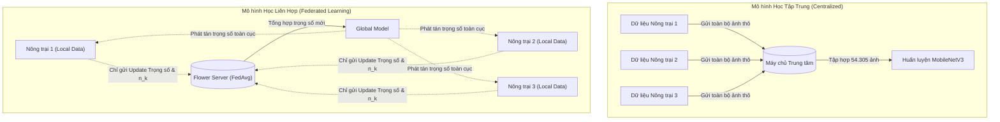
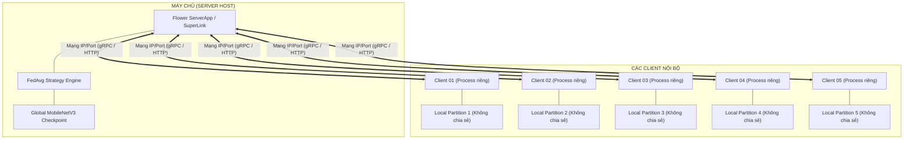
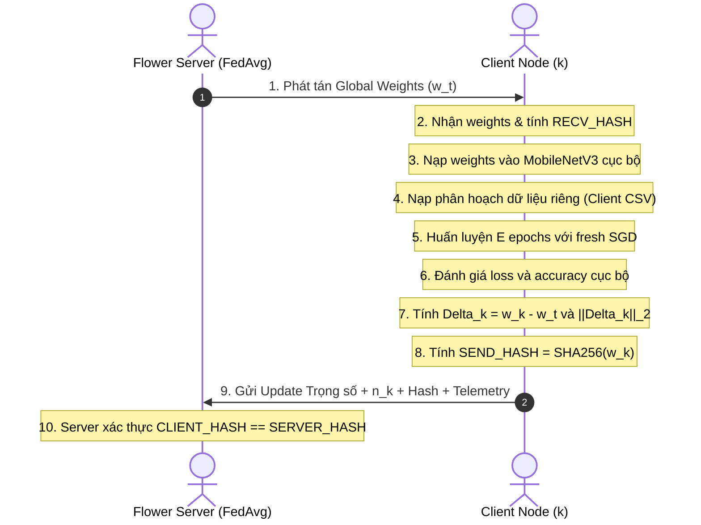
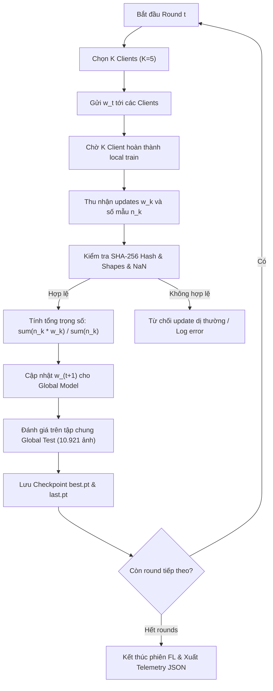
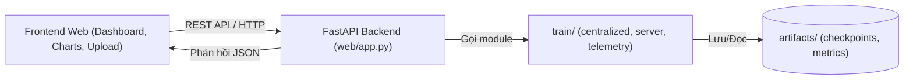

# Kiến Trúc Hệ Thống Federated Learning (System Architecture)

Tài liệu này cung cấp các sơ đồ kiến trúc chuẩn hóa phục vụ báo cáo và phản biện đồ án tốt nghiệp với hội đồng.

---

## 1. So Sánh Mô Hình Tập Trung (Centralized) vs Phân Tán (Federated)

---

## 2. Kiến Trúc Triển Khai Flower Thực Tế (Deployment Topology)

Mô hình triển khai chuẩn: Server và các Client chạy trên các process/máy tính độc lập, kết nối qua mạng IP/Port.

---

## 3. Vòng Đời Huấn Luyện Cục Bộ Của Client (Client Lifecycle)

---

## 4. Giao Thức Tổng Hợp FedAvg Tại Server

$$w_{t+1} = \sum_{k=1}^K \frac{n_k}{\sum_j n_j} w_{k, t+1}$$

---

## 5. Kiến Trúc Tầng Ứng Dụng Web (Web Presentation & Inference)

