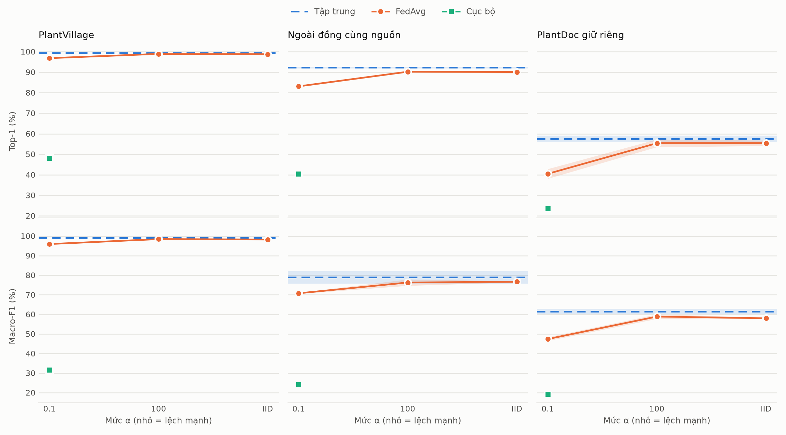
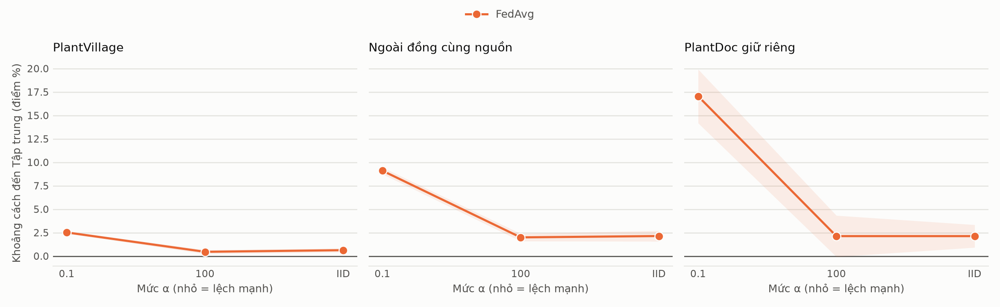

# Kiểm chứng huấn luyện phân tán và tập trung

> **Bản tạm cho demo: mới xong 9/18 run chất lượng.** Phần còn lại của quét α đang chạy; số về các mức α chưa xong chưa có trong bảng.

Báo cáo này trả lời chín yêu cầu bằng checkpoint, nhật ký và phép đo thật. Các run chất lượng dùng năm client mô phỏng Flower/Ray trên một GPU; phép đo mạng dùng hai client thật trên hai máy. Không đánh giá PlantWild cho run mới và không mở độ chính xác tập niêm phong.

## 1. Trọng số có sai lệch khi truyền không

Đối chiếu 2400 lượt SHA-256 hai chiều trên 6 run Flower, mỗi run 40 vòng và năm client: tất cả đạt. Client băm đúng trọng số nhận/gửi, server băm trọng số gửi/nhận; bất kỳ lệch nào làm run dừng. Preflight riêng đạt 30 lượt. Byte Flower là payload mảng đã tuần tự hóa, không gồm toàn bộ khung truyền mạng.

| Run | Lượt hash | Gửi lên MB | Gửi xuống MB | Sai lệch gộp lớn nhất |
|---|---|---|---|---|
| fedavg_s42_label_alpha_0_1_flower | 400 | 1261.44 | 1261.44 | 2.980e-08 |
| fedavg_s123_label_alpha_0_1_flower | 400 | 1261.44 | 1261.44 | 5.960e-08 |
| fedavg_s2026_label_alpha_0_1_flower | 400 | 1261.44 | 1261.44 | 1.192e-07 |
| fedavg_s42_iid_flower | 400 | 1261.44 | 1261.44 | 2.980e-08 |
| fedavg_s123_iid_flower | 400 | 1261.44 | 1261.44 | 2.384e-07 |
| fedavg_s2026_iid_flower | 400 | 1261.44 | 1261.44 | 5.960e-08 |

## 2. Sai lệch so với huấn luyện tập trung

Phép A dùng GD toàn batch, không momentum/dropout, BatchNorm đóng băng. Đây là phép kiểm công thức, không phải toàn bộ công thức SGD minibatch của các run chất lượng. Ngưỡng chốt trước: max_abs ≤ 1e-10 và L2 tương đối ≤ 1e-9 cho float64.

| Phép | Cách chia | Kiểu số | Bước cục bộ | L2 | Max abs | Dự đoán trùng |
|---|---|---|---|---|---|---|
| A_fedsgd | label_alpha_0_1 | float64 | 1 | 4.863e-11 | 8.224e-12 | 100.00% |
| A_fedsgd | iid | float64 | 1 | 1.224e-11 | 2.642e-12 | 100.00% |
| A_fedsgd | label_alpha_0_1 | float32 | 1 | 1.238e-01 | 1.406e-02 | 76.47% |
| B_local_steps | iid | float64 | 2 | 2.818e-01 | 2.143e-02 | 80.88% |
| B_local_steps | iid | float64 | 5 | 2.908e-01 | 2.090e-02 | 69.12% |
| B_local_steps | iid | float64 | 10 | 3.075e-01 | 2.310e-02 | 67.65% |
| B_local_steps | label_alpha_0_1 | float64 | 2 | 2.864e-01 | 2.079e-02 | 75.00% |
| B_local_steps | label_alpha_0_1 | float64 | 5 | 3.513e-01 | 3.745e-02 | 72.06% |
| B_local_steps | label_alpha_0_1 | float64 | 10 | 3.771e-01 | 3.397e-02 | 61.76% |
| C_batchnorm_live | iid | float64 | 1 | 2.654e-01 | 9.835e-03 | 75.00% |
| C_batchnorm_live | label_alpha_0_1 | float64 | 1 | 3.080e-01 | 1.438e-02 | 77.94% |

Đọc bảng trên: phép A float64 đạt ngưỡng, nên công thức gộp không tạo sai lệch. Phép A float32 lệch lớn hơn nhiều, nhưng không thể quy cho học phân tán: đối chứng D chạy tập trung hai lần trên cùng ảnh, chỉ đổi thứ tự ảnh trong batch, về toán học phải trùng, mà ở float32 vẫn lệch cùng cỡ. Float64 cũng khuếch đại khi đủ nhiều bước (bảng dưới, 20 bước) nhưng từ mức nền nhỏ hơn rất nhiều, nên vẫn đạt ngưỡng. Cơ chế cụ thể của sự khuếch đại chưa được chứng minh, nên báo cáo chỉ khẳng định phần đã đo được. Phép kiểm dùng ít ảnh và GD toàn batch nên tỉ lệ dự đoán trùng ở đây không đại diện cho độ chính xác của mô hình đã train.

| Kiểu số | Số bước | Đối chứng đổi thứ tự: L2 | FedSGD: L2 | Dự đoán trùng đối chứng | Dự đoán trùng FedSGD |
|---|---|---|---|---|---|
| float64 | 1 | 2.931e-16 | 2.056e-14 | 100.0% | 100.0% |
| float64 | 2 | 9.417e-16 | 3.140e-14 | 100.0% | 100.0% |
| float64 | 5 | 2.787e-15 | 5.921e-14 | 100.0% | 100.0% |
| float64 | 10 | 4.209e-15 | 1.042e-13 | 100.0% | 100.0% |
| float64 | 20 | 1.691e-10 | 1.510e-10 | 100.0% | 100.0% |
| float32 | 1 | 3.051e-07 | 4.732e-04 | 100.0% | 100.0% |
| float32 | 2 | 4.455e-04 | 1.654e-03 | 100.0% | 98.5% |
| float32 | 5 | 2.814e-02 | 3.063e-02 | 73.5% | 86.8% |
| float32 | 10 | 9.348e-02 | 9.520e-02 | 47.1% | 48.5% |
| float32 | 20 | 1.514e-01 | 1.210e-01 | 60.3% | 73.5% |

Khoảng cách giữa checkpoint đã train được tách tham số học được và thống kê BatchNorm. Hash W0 của run mới phải khớp W0 dựng lại theo seed. V4b không ghi hash lúc train: dựng lại công thức không chứng minh được trạng thái khởi tạo thực tế của lần chạy cũ.

| Run | L2 tham số | L2 thống kê BN | Dự đoán trùng tập thử |
|---|---|---|---|
| fedavg_s123 | 29.3414 | 114.2650 | 94.85% |
| fedavg_s2026 | 29.3259 | 113.0327 | 94.92% |
| fedavg_s42 | 29.1652 | 112.1387 | 94.72% |
| fedavg_s123_iid_flower | 29.2541 | 118.5476 | 97.76% |
| fedavg_s123_label_alpha_0_1_flower | 29.3378 | 113.8331 | 94.89% |
| fedavg_s123_label_alpha_100_0 | 28.4756 | 113.7547 | 97.93% |
| fedavg_s2026_iid_flower | 28.5613 | 113.3676 | 98.23% |
| fedavg_s2026_label_alpha_0_1_flower | 29.3331 | 113.1213 | 94.99% |
| fedavg_s2026_label_alpha_100_0 | 29.4553 | 119.6906 | 97.95% |
| fedavg_s42_iid_flower | 28.7866 | 115.7004 | 97.30% |
| fedavg_s42_label_alpha_0_1_flower | 29.2790 | 112.5639 | 94.63% |
| fedavg_s42_label_alpha_100_0 | 28.4094 | 112.9251 | 97.99% |

## 3. Phương pháp kiểm tra

Kiểm SHA gói trước giải nén, hash release và từng shard; kiểm W0; hash trao đổi từng vòng; tính lại phép gộp bằng NumPy float64 độc lập; so checkpoint và ghép dự đoán theo sample_id. Các test cố ý đổi một bit, gộp đều thay vì theo n_k, thiếu client/vòng và NaN phải bị phát hiện. Phép thử GPU dùng đúng gpu_v2, channels-last, batch 128, lr 0,02, bf16, workers 8, limit 3000, budget 3.

Bằng chứng: [preflight](../artifacts/distributed_verification/preflight_passed.json), [log test](../artifacts/distributed_verification/preflight_tests.log), [kiểm toán từng run](../artifacts/distributed_verification/batch_audit.json), [checkpoint](../artifacts/distributed_verification/weight_comparison.json).

## 4. Chạy nhiều client

| Cách chia | Client 0 | Client 1 | Client 2 | Client 3 | Client 4 |
|---|---|---|---|---|---|
| label_alpha_0_1 | 13107 | 11691 | 6647 | 8863 | 12156 |
| iid | 10527 | 10502 | 10502 | 10478 | 10455 |
| label_alpha_100_0 | 10760 | 10512 | 9994 | 10599 | 10599 |
| label_alpha_10_0 | 10864 | 10301 | 9274 | 10651 | 11374 |
| label_alpha_1_0 | 11606 | 9031 | 10941 | 9357 | 11529 |
| label_alpha_0_5 | 10602 | 10571 | 8818 | 11750 | 10723 |

Năm shard là phân hoạch dữ liệu train, không phải năm máy vật lý. Phép đo mục 8 dùng hai máy vật lý.

## 5. Thông số Flower theo vòng

Môi trường đo: PyTorch 2.11.0+cu128, Flower 1.36.0, Ray 2.55.1, NVIDIA GeForce RTX 3090. Mọi run chính dùng 40 vòng, E=1, SGD momentum 0,9, weight decay 1e-4, lr 0,02 cosine, batch 128, label smoothing 0,1, gpu_v2 và bf16. [Bảng từng vòng](../artifacts/distributed_verification/round_metrics.csv) chứa lr, val, kiểm gộp và thời gian; [bảng từng client](../artifacts/distributed_verification/client_metrics.csv) chứa loss, delta_l2, khoảng cách đến mô hình gộp, byte và thời gian. Val tham gia chọn checkpoint; số chất lượng chính bên dưới lấy trên tập thử.

## 6. Mô hình gộp khác mô hình client thế nào

Sai lệch phép gộp lớn nhất qua 360 vòng là 2.384e-07. Mọi run đều chạy mã ed88947eb nên dùng cổng tuyệt đối 1e-6; đơn vị làm tròn theo thang tensor mới có trong mã sau đó, nhật ký các run này không có trường đó. Đây là chênh lệch giữa hai cách tính số học của phép gộp, không phải phép so bit. Cổng ban đầu 1e-7 đã được sửa thành 1e-6 trong quá trình chạy sau khi gặp đúng epsilon float32 tại thang 1. Phép tính lại trên năm checkpoint Local-only thật cho thấy thứ tự nhân/chia có thể làm hai kết quả float32 lệch một ULP; xem [kiểm tra làm tròn](../artifacts/distributed_verification/aggregation_roundoff_analysis.json). Đây là điều chỉnh ngưỡng kỹ thuật được công khai sau quan sát, không phải ngưỡng đặt trước; ngưỡng FedSGD A không đổi. Nhật ký chưa ghi ULP từng tensor nên không khẳng định mọi vòng trùng một ULP. l2_to_merged là khoảng cách thật giữa mô hình client sau học và mô hình chung sau gộp, không phải lỗi truyền. Tính công bằng được tổng hợp trong [table_fairness.csv](../artifacts/sweep_v4/table_fairness.csv): dùng độ chính xác mô phỏng phân phối miền–lớp của shard trên tập đo, có báo độ phủ; không phải tập thử cục bộ mới thu thập ở từng cơ sở.

| Cách chia | Biến thể | Accuracy client (%) | SD giữa client (điểm %) | Mạnh − yếu (điểm %) | Client nhỏ nhất (%) | Độ phủ tối thiểu (%) |
|---|---|---|---|---|---|---|
| iid | fedavg+flower | 93.26 ± 0.34 | 0.32 ± 0.01 | 0.86 ± 0.08 | 93.24 ± 0.32 | 98.80 |
| label_alpha_0_1 | fedavg | 88.58 ± 0.24 | 4.67 ± 0.30 | 13.54 ± 0.89 | 79.90 ± 0.83 | 98.08 |
| label_alpha_0_1 | fedavg+flower | 88.81 ± 0.21 | 4.55 ± 0.49 | 12.81 ± 1.25 | 80.51 ± 1.29 | 98.08 |
| label_alpha_0_1 | local | 96.57 ± 0.21 | 1.11 ± 0.18 | 3.14 ± 0.60 | 96.99 ± 0.26 | 98.08 |
| label_alpha_100_0 | fedavg | 93.37 ± 0.24 | 0.59 ± 0.03 | 1.63 ± 0.07 | 93.55 ± 0.25 | 98.56 |
## 7. Code backend tập trung và phân tán

| Vai trò | Mã nguồn |
|---|---|
| Chuẩn bị ba mốc và vòng lặp train/val/checkpoint | [scripts/train_v4.py:103](../scripts/train_v4.py#L103) |
| Một vòng mô phỏng một tiến trình | [scripts/train_v4.py:275](../scripts/train_v4.py#L275) |
| Vòng lặp chung, nhánh Centralized/Local và FedAvg | [scripts/train_v4.py:289](../scripts/train_v4.py#L289) |
| Gửi/nhận Flower và kiểm toàn vẹn | [src/federated/flower_app.py:198](../src/federated/flower_app.py#L198); [src/federated/flower_app.py:168](../src/federated/flower_app.py#L168) |
| Client Flower gọi bộ train dùng chung | [src/federated/flower_app.py:93](../src/federated/flower_app.py#L93) |
| Huấn luyện một client | [src/training/client_round.py:86](../src/training/client_round.py#L86) |
| Gộp trung bình theo n_k | [src/federated/strategy.py:55](../src/federated/strategy.py#L55) |
| Server deployment cho phép đo WAN | [src/federated/server_app.py:762](../src/federated/server_app.py#L762) |
| Client deployment cho phép đo WAN | [src/federated/client_app.py](../src/federated/client_app.py) |

Nhánh tập trung chuẩn bị toàn bộ tập train, rồi dùng train_epoch trong vòng lặp chung:

[scripts/train_v4.py:189](../scripts/train_v4.py#L189)

```python
    if args.method == "centralized":
        train_sets = [subset(release["train"], args.limit, args.seed)]
    elif args.method == "fedavg":
        train_sets = [subset(load_shard(release_dir, args.scheme, k, release), args.limit // NUM_CLIENTS if args.limit else 0, args.seed + k)
                      for k in range(NUM_CLIENTS)]
    else:
        train_sets = [subset(load_shard(release_dir, args.scheme, args.client, release), args.limit, args.seed)]
```

[scripts/train_v4.py:317](../scripts/train_v4.py#L317)

```python
                for group in optimizer.param_groups:
                    group["lr"] = lr
                only = clients[0]
                train_info = train_epoch(model, only["loader"], optimizer, scaler, device, only["weights"], args.label_smoothing, only["augment"], only["adjust"],
                                         args.channels_last, args.amp)
            val = summarize(predict(model, eval_loaders["val"], device, args.channels_last, args.amp), eval_rows["val"])
```

Đường phân tán gửi trọng số cho từng client, nhận cập nhật và kiểm hash trước gộp:

[src/federated/flower_app.py:206](../src/federated/flower_app.py#L206)

```python
    def run_round(step: int, lr: float, parent: dict[str, Any]) -> tuple[list[dict[str, Any]], list[dict[str, Any]]]:
        arrays, extra = state_to_record(parent), state_to_record(algo.download())
        bytes_down = record_bytes(arrays) + record_bytes(extra)
        sent_down = compute_model_hash(parent)
        config = ConfigRecord({"plan": plan_json, "step": step, "lr": lr})
        messages = [Message(RecordDict({"arrays": arrays, "extra": extra, "config": config}), dst_node_id=located[k], message_type=MessageType.TRAIN) for k in sorted(located)]
        replies = _replies_or_raise(grid.send_and_receive(messages, timeout=timeout), len(messages), f"học ở vòng {step}")
        updates, client_stats = [], []
        for reply in replies:
            stats = json.loads(str(reply.content["report"]["stats"]))
            weights = record_to_state(reply.content["arrays"])
            stats = check_transport(stats, sent_down, compute_model_hash(weights))
            if plan.compression:
                weights = decode_update(weights, parent, plan.compression)
            num_examples = int(stats.pop("num_examples"))
            algo.absorb_upload(stats["client"], record_to_state(reply.content["extra"]), weights)
```

Phần gộp tích lũy float64 theo số ảnh của client rồi đưa về kiểu số gốc:

[src/federated/strategy.py:133](../src/federated/strategy.py#L133)

```python
            n_k = update["num_examples"]
            t = update["weights"][key]
            t_np = t.detach().cpu().numpy() if isinstance(t, torch.Tensor) else t
            acc += (t_np.astype(np.float64) * n_k)

        acc = acc / total_samples
        aggregated[key] = torch.from_numpy(acc).to(dtype=original_dtype)
```


## 8. Tốc độ trên hai máy

Laptop i5-12500H CPU và máy thuê RTX 3090, OMP/MKL 2 luồng; SSH tunnel qua cổng 3000 cho 18089 và 18090; client 1 cùng máy chủ; 380 ảnh/client, 2 epoch/vòng, 3 vòng, seed 42. Chỉ đo tốc độ, không dùng làm kết quả độ chính xác.

Đường WAN dùng backend deployment gRPC và shard PlantVillage nhỏ; không thay thế thí nghiệm chất lượng v4 trên Flower/Ray.

| Máy | Train cục bộ trung vị (s) | Ảnh thực xử lý/s | RTT trung vị (ms) | Lên MiB/s | Xuống MiB/s |
|---|---|---|---|---|---|
| laptop_i5_12500h_cpu | 18.005 | 42.21 | 1425.365 | 2.511 | 0.446 |
| may_thue_rtx3090 | 0.899 | 845.38 | 0.095 | 4706.261 | 7064.758 |

Ba vòng đều đủ hai client thật, hash đúng và không bị từ chối. Trung vị thời gian fit một vòng: 62.431 s. Đồng hồ đo ở chính máy thực hiện tác vụ. Thời gian fit có cả probe RTT/băng thông chủ động, không đại diện vòng train không gắn probe. Không dùng thời gian các đợt v4b/Flower hoặc khối C chạy song song để suy riêng chênh lệch tốc độ runtime. Ảnh thực xử lý/s tính cả hai epoch; chỉ số cũ train_images_per_s chỉ lấy số ảnh duy nhất trong shard. Băng thông dùng MiB=2^20 byte; bảng truyền thông sweep dùng MB=10^6 byte. [History và summary](../artifacts/network_speedtest/20261102T143913Z_wan_may_thue/summary.json).

## 9. Khác biệt và giới hạn

| Cách chia | Biến thể | Toàn tập thử top-1 (%) | PlantVillage (%) | Ngoài đồng cùng nguồn (%) | PlantDoc (%) |
|---|---|---|---|---|---|
| toàn bộ | centralized | 97.69 ± 0.18 | 99.38 ± 0.16 | 92.23 ± 0.47 | 57.56 ± 1.54 |
| iid | fedavg+flower | 96.80 ± 0.38 | 98.75 ± 0.37 | 90.09 ± 0.59 | 55.43 ± 1.34 |
| label_alpha_0_1 | fedavg | 93.93 ± 0.12 | 96.85 ± 0.04 | 83.13 ± 0.37 | 40.50 ± 2.35 |
| label_alpha_0_1 | fedavg+flower | 94.03 ± 0.10 | 96.81 ± 0.10 | 84.08 ± 0.42 | 39.73 ± 2.20 |
| label_alpha_0_1 | local | 46.55 ± 0.13 | 48.09 ± 0.07 | 40.46 ± 0.65 | 23.68 ± 0.76 |
| label_alpha_100_0 | fedavg | 96.97 ± 0.14 | 98.92 ± 0.08 | 90.24 ± 0.37 | 55.43 ± 1.87 |






Số liệu là trung bình ± độ lệch chuẩn mẫu qua ba seed. Chi tiết macro-F1, khoảng tin cậy, chênh lệch ghép seed, vòng hội tụ và byte ở [table_main.csv](../artifacts/sweep_v4/table_main.csv) và [results.json](../artifacts/sweep_v4/results.json). Không dùng việc kiểm định không bác bỏ khác biệt để khẳng định tương đương. Cần đọc chênh lệch Flower–mô phỏng bên cạnh độ dao động seed.

| Cách chia | Tập đo | Flower − mô phỏng (điểm %) | CI95 theo cụm | Mốc mô phỏng trung bình ± SD (%) |
|---|---|---|---|---|
| iid | all_test | chưa có mốc mô phỏng cùng cách chia | — | — |
| iid | plantvillage_test | chưa có mốc mô phỏng cùng cách chia | — | — |
| iid | field_same_source_test | chưa có mốc mô phỏng cùng cách chia | — | — |
| iid | plantdoc_holdout_v3 | chưa có mốc mô phỏng cùng cách chia | — | — |
| label_alpha_0_1 | all_test | 0.11 | [-0.06; 0.28] | 93.93 ± 0.12 |
| label_alpha_0_1 | plantvillage_test | -0.04 | [-0.17; 0.08] | 96.85 ± 0.04 |
| label_alpha_0_1 | field_same_source_test | 0.96 | [0.22; 1.87] | 83.13 ± 0.37 |
| label_alpha_0_1 | plantdoc_holdout_v3 | -0.78 | [-3.33; 1.78] | 40.50 ± 2.35 |

Chênh lệch lớn hơn SD của cả hai bên tại: label_alpha_0_1/field_same_source_test. Vì vậy không kết luận hai pipeline tương đương trên mọi nhóm dữ liệu. Đây là so sánh thang dao động mô tả, không phải kiểm định tương đương.

Môi trường V4b: NVIDIA GeForce RTX 3090, torch 2.11.0+cu128, Python 3.10.12, mã 93c5f80fd; Flower: NVIDIA GeForce RTX 3090, torch 2.11.0+cu128, Python 3.12.3, mã ed88947eb. Dropout của Flower lấy RNG trong tiến trình client. Không quy riêng mọi chênh lệch quan sát được cho đường truyền hoặc runtime.

Tổng ảnh train để gửi một lần về trung tâm: 1524.05 MB cho 52464 ảnh đã mã hóa.

| Cách chia | Biến thể | MB gửi lên | MB hai chiều | Hai chiều / gửi ảnh | Vòng hội tụ seed 42/123/2026 |
|---|---|---|---|---|---|
| iid | fedavg+flower | 1261.44 | 2522.87 | 1.655× | 22/30/30 |
| label_alpha_0_1 | fedavg | 1255.19 | 2510.38 | 1.647× | chưa đạt/39/29 |
| label_alpha_0_1 | fedavg+flower | 1261.44 | 2522.87 | 1.655× | 40/39/36 |
| label_alpha_100_0 | fedavg | 1255.19 | 2510.38 | 1.647× | 32/chưa đạt/20 |

Byte của mô phỏng v4b được suy từ tensor; byte Flower được ghi từ payload mảng, đều chưa gồm mọi khung giao thức. So sánh MB hai chiều với ảnh gửi một lần không khẳng định FL luôn tiết kiệm băng thông. Hội tụ ở đây là chỉ số val giữ trong một điểm macro-F1 so với mức tốt nhất đến hết run. Seed chưa đạt được ghi rõ, không lấy trung bình hai seed rồi trình bày như đủ ba seed. Chi phí đến hội tụ trong CSV dùng hết ngân sách khi seed chưa đạt; cần đọc cùng cờ này.


IID chỉ chạy Flower trong đợt này; không có đối chứng IID một tiến trình để suy ra tương đương runtime ở IID. Đường theo α dự kiến có năm mức FedAvg và mốc Centralized, hiện mới có các mức đã xong; Local-only chỉ được đo ở α=0,1, không nội suy thành số đo ở các α còn lại.

Khoảng cách production còn chịu tác động của nhiều bước minibatch cục bộ, SGD momentum được làm mới mỗi vòng client, BatchNorm, dropout/tăng cường ngẫu nhiên và cách chuẩn hóa mất mát theo shard/batch. B/C chứng minh một số cơ chế tạo lệch, không phân rã định lượng toàn bộ khoảng cách đã train. Test PlantDoc nhỏ; độ chính xác mô hình toàn cục và độ chính xác theo phân phối client là hai phép đo khác nhau.

Trong mô phỏng Ray, các shard nằm cùng máy và dùng chung hệ thống tệp. Việc chỉ truyền trọng số trong giao thức không chứng minh cô lập dữ liệu giữa các tổ chức; đợt này không kiểm chứng DP hay secure aggregation.

## Các lượt đã train và phạm vi còn thiếu

| Run mới | Seed | Runtime | Vòng | Tổng thời gian vòng (s) |
|---|---|---|---|---|
| fedavg_s42_label_alpha_0_1_flower | 42 | flower | 40 | 633.90 |
| fedavg_s123_label_alpha_0_1_flower | 123 | flower | 40 | 635.90 |
| fedavg_s2026_label_alpha_0_1_flower | 2026 | flower | 40 | 635.50 |
| fedavg_s42_iid_flower | 42 | flower | 40 | 629.10 |
| fedavg_s123_iid_flower | 123 | flower | 40 | 627.40 |
| fedavg_s2026_iid_flower | 2026 | flower | 40 | 627.00 |
| fedavg_s42_label_alpha_100_0 | 42 | simulation | 40 | 1650.60 |
| fedavg_s123_label_alpha_100_0 | 123 | simulation | 40 | 1664.10 |
| fedavg_s2026_label_alpha_100_0 | 2026 | simulation | 40 | 1628.00 |

Đến lúc sinh bản này đã xong 9/18 run mới (kế hoạch: 6 run Flower và 12 run quét α); dùng lại 21 run v4b. Preflight và phép đo mạng không tính vào 18 run chất lượng. Không train thêm FedProx/FedBN/SCAFFOLD/MOON, DP, Local-only theo α hoặc cá nhân hóa; không mở tập niêm phong.

Theo file Word, đợt này bổ sung bằng chứng cho N1.2, N1.3, N2.3 và demo hai client thật của N4.4. N2.1/N2.4 còn thiếu Local-only ở các α khác; N2.2 có phân hoạch nhưng chưa train lệch số lượng/nguồn. Chưa hoàn thành thí nghiệm thuật toán và dò siêu tham số Đợt 3, kiểm thử niêm phong N5.3 hay quyển báo cáo/bản thảo N5.5. Không suy ra mức 60%, 85% hoặc 100% chỉ từ 18 run này.

## Đối chiếu từng nhiệm vụ trong file Word

| Nhiệm vụ | Bằng chứng và phần còn thiếu |
|---|---|
| N1.1 | V4b có Centralized SGD cùng công thức; chưa bổ sung đối chứng AdamW cùng release trong đợt này. |
| N1.2 | Đã chạy Flower ba seed và đo chênh lệch với mô phỏng ở α=0,1; kết luận theo bảng chênh lệch, không mặc định đạt tương đương. |
| N1.3 | Run FedAvg mới có nhật ký đủ vòng, hash, delta và thời gian; chưa chạy lại Local-only để bổ sung trường nhật ký cũ còn thiếu. |
| N1.4 | Giữ thiết kế tập niêm phong hiện có; không mở độ chính xác trong đợt này. |
| N2.1 | FedAvg năm α đang chạy, chưa đủ; Local-only còn thiếu ở các α khác. |
| N2.2 | Đã có phân hoạch lệch số lượng/nguồn; chưa train hai dạng này trong đợt hiện tại. |
| N2.3 | Có accuracy mô phỏng phân phối client và độ phủ trong bảng fairness. |
| N2.4 | Có đường Centralized/FedAvg theo α; Local-only chỉ có điểm α=0,1. |
| N3.1 | Mã thuật toán có test; chưa có bộ thí nghiệm Flower đầy đủ cho bốn thuật toán. |
| N3.2 | Chưa dò siêu tham số các thuật toán trong đợt này. |
| N3.3 | Chưa thực nghiệm cải tiến mới đủ ba seed trong đợt này. |
| N3.4 | Chưa có so sánh cải tiến để nghiệm thu thu hẹp khoảng cách. |
| N4.1 | Có artifact lượng tử hóa lịch sử; đợt này không đo lại trên thiết bị đích. |
| N4.2 | Đã đo payload và hội tụ; chưa train thêm kỹ thuật nén cập nhật để đo đánh đổi. |
| N4.3 | Không chạy DP theo phạm vi đã chốt; chưa có đường epsilon–accuracy. |
| N4.4 | Đã chạy hai client thật trên hai máy; server đồng máy client GPU. |
| N5.1 | Có bảng ba mốc và FedAvg nhiều α; còn thiếu thuật toán cải tiến và Local-only nhiều α. |
| N5.2 | Có chất lượng, non-IID, truyền thông và fairness; riêng tư mới phân tích giới hạn, không có bảo đảm DP. |
| N5.3 | Chưa chạy tập niêm phong, đúng ràng buộc của đợt này. |
| N5.4 | Có script, cấu hình, mã băm, bảng/biểu đồ và hướng dẫn tái lập bên dưới. |
| N5.5 | Có báo cáo kiểm chứng Markdown; chưa tạo quyển tốt nghiệp Word hoặc bản thảo bài báo. |

## Tái lập

Toàn bộ 18 run dùng cùng mã train ed88947eb (code_fingerprint giống nhau). Commit và code_fingerprint của từng run nằm trong batch_audit.json; script kiểm chứng và kết quả nằm trên nhánh codex/continue-flower-verification. Gói đầu vào có manifest SHA riêng, không dùng bundle.json cũ. Trên máy thuê, chạy preflight trong tmux, sau khi kiểm dữ liệu; chỉ chạy train khi cả preflight_passed.json và network_speedtest_passed.json đạt.

```bash
bash scripts/remote/run_verification_batch.sh preflight /root/cropfed
bash scripts/remote/run_verification_batch.sh train /root/cropfed
```

Sau khi kéo đủ run đã kiểm SHA, tại gốc repo:

```bash
python scripts/eval_sweep_v4.py --runs runs/v4b runs/v4_sweep --threads 2
python scripts/compare_v4_checkpoints.py --baseline-runs runs/v4b --runs runs/v4b runs/v4_sweep --out artifacts/distributed_verification/weight_comparison.json
python scripts/report_distributed_verification.py --network-summary artifacts/network_speedtest/20261102T143913Z_wan_may_thue/summary.json
```
