# Review UI/UX và nội dung CropFed FL — 14/10/2026

Giai đoạn này **chỉ review và đề xuất**: không sửa mã giao diện hay backend, không đổi số liệu, mô hình hay thuật toán.
Báo cáo gồm: A tổng quan · B từng màn hình · C riêng luồng Client FL · D nội dung · E bản đồ kỹ thuật · F roadmap · G checklist nghiệm thu.

## 0. Phạm vi, phương pháp và giới hạn

**Bản được kiểm.** Production `https://datn.tranngochung.id.vn` (VM Oracle). Mã phục vụ trùng commit `f685d9ddc`: so SHA-256 của
`index.html`, `community.js`, `diagnosis.js`, `results.js`, `router.js`, `pages.css`, `style.css` giữa production và `HEAD` — trùng từng byte.
Vì vậy các luồng có ghi trạng thái được kiểm trên máy chủ local chạy cùng mã, và kết quả đại diện cho production.

**Cách kiểm.**

| Lớp | Cách làm | Quy mô |
|---|---|---|
| Ma trận hiển thị | Chromium trên production, chỉ GET: 6 bước + 5 tab con Kết quả + `/quan-tri` × 390, 768, 1440, 1920 px × sáng/tối | 96 trạng thái; thêm 1280×720 (máy chiếu), 720 px ở tỉ lệ 2× (zoom 200%), giảm chuyển động |
| Khác trình duyệt | Firefox 146 và WebKit 26 (bản Playwright), production, chỉ GET, 390 và 1440 px | 2 × 48 trạng thái |
| Trợ năng | axe-core 4.10.2, mọi mức độ, 12 trạng thái × 2 rộng × 2 theme; bàn phím (Tab, skip link, mũi tên) | production |
| Luồng ghi trạng thái | Máy chủ uvicorn local (bí mật tạm, state tạm): Client FL đầy đủ, 11 tình huống lỗi, chẩn đoán, cổng huấn luyện, quản trị | local |
| Tiêm lỗi | `page.route`: mất phản hồi, 429 HTML, 5xx, offline, chặn tải mô hình; sự kiện lỗi của worker; mạng 4G chậm | local |
| Nội dung | Lấy chữ thật hiển thị ở từng trang sau khi mở mọi khối gập, đọc từng câu; đối chiếu với API | production |
| Hồi quy | `pytest`, `scripts/e2e_community.py`, `scripts/ui_audit.py` | local |

**An toàn.** Toàn bộ phiên review không gửi POST nào tới production (đếm trong log mạng: 0 yêu cầu khác GET). Không đăng nhập admin, không mở phiên cộng đồng, không chạy huấn luyện.
Trạng thái production trước và sau review giống nhau (task `idle`, phiên cộng đồng đóng, phiên bản 0).

**Phân loại phát hiện.**

- **[X] Lỗi đã xác nhận bằng kiểm thử** — tái hiện được, có bằng chứng.
- **[U] Vấn đề UX có bằng chứng** — gây hiểu sai hoặc cản trở, có ảnh hoặc số đo.
- **[S] Đề xuất tùy chọn** — cải thiện, không phải lỗi.

**Mức ưu tiên.** P0: sai chức năng, sai số liệu, bảo mật hoặc khẳng định khoa học sai · P1: cản trở hoàn thành tác vụ hoặc gây hiểu sai đáng kể ·
P2: ma sát, thiếu nhất quán · P3: tinh chỉnh.

**Giới hạn của lần review này.**

- Không có trình đọc màn hình, điện thoại hay Safari thật. WebKit ở đây là bản Playwright cho Windows, không phải Safari.
- Chưa chạy phiên Flower thật (không được chạy job nặng trên production; máy local thiếu `flwr`). Huy hiệu và bảng tiến độ Flower được kiểm bằng trạng thái giả lập đúng cấu trúc của máy chủ.
- Ảnh chụp từng phần tử có thể bị thanh điều hướng cố định phủ lên (hiện tượng của công cụ chụp, không phải lỗi giao diện).
- Mạng chậm được giả lập (1,6 Mbps, trễ 150 ms) trên máy chủ local không nén gzip; số byte nén trên production đo riêng.

---

## A. Đánh giá tổng quan

### A.1 Điểm mạnh

1. **Minh bạch khoa học tốt hơn mức thông thường của một đồ án.** Mọi con số chính đi kèm phạm vi và giới hạn: tập kiểm tra cũng dùng để chọn mô hình, tập giữ riêng chưa được đối soát trùng ảnh, một seed, client là phân vùng giả lập. Có khoảng tin cậy bootstrap theo cụm, McNemar, độ nhạy với ảnh chụp lại cùng lá, mã băm SHA-256.
2. **Số liệu nhất quán.** Số trên giao diện khớp API: FedAvg 93,12%, Centralized 99,22%, Local-only 44,9–55,5% (PlantVillage); 18/38 nhóm có ≥ 90% ảnh ở một client; Tomato bacterial spot 97% ở client 02 (1.549/1.597 ảnh).
3. **Kết luận đứng trước bảng.** Trang Tổng quan mở bằng ba chỉ số chính; tab Kết quả có một câu kết luận trước bảng dữ liệu.
4. **Trạng thái lỗi tốt ở luồng chẩn đoán.** PDF, tệp rỗng, > 10 MB, ảnh hỏng, 500, 504 HTML, offline đều có thông báo tiếng Việt rõ nguyên nhân và đường thử lại; chọn ảnh liên tiếp nhanh không hiển thị kết quả cũ; bấm đúp chỉ gửi một yêu cầu.
5. **Bảo vệ tài nguyên đúng chỗ.** Ba API huấn luyện trả 401 nếu không đăng nhập; giao diện không gửi yêu cầu nào khi chưa đăng nhập; các lỗi 401/409/422/429/503 đều có câu giải thích riêng.
6. **Hiển thị ổn định.** 0 tràn ngang trong 192 trạng thái ở 3 trình duyệt; không lỗi console, không HTTP ≥ 400; axe không có lỗi nghiêm trọng hay lỗi tương phản; LCP mobile 4G chậm 1,9–2,2 s, CLS ≤ 0,08.
7. **Luồng Client FL chạy được trọn vẹn** trên Chromium và Firefox; ảnh không rời máy (không có POST multipart nào); vòng gộp đúng; E2E của repo 50/50.

### A.2 Điểm yếu

1. **Một số khẳng định đã lỗi thời nhưng vẫn hiển thị** (kết quả nghiệm thu "trên đúng mã nguồn hiện tại"; "máy chủ công khai chỉ có 2 GB RAM" trong khi máy hiện có 64 GB).
2. **Luồng Client FL còn nhiều ngõ cụt** khi có lỗi hoặc sau khi tải lại trang: nút khóa không giải thích, thông báo sai ("không nhận" trong khi máy chủ đã nhận), phục hồi sau lỗi worker không thành công.
3. **Bước 5 không trình diễn được nếu không có quản trị viên**: phiên đóng là mặc định; khách thấy một biểu mẫu bị khóa và không có hướng dẫn để thử.
4. **Văn phong chưa thống nhất**: xen kẽ giọng kể chuyện, giọng báo cáo và giọng kỹ thuật; thuật ngữ nhiều (backbone, validation, McNemar, Bonferroni, legacy); "tự tin" và "độ tin cậy" dùng lẫn; một số mã nội bộ hiện nguyên văn.
5. **Cách trình bày tiến độ dễ gây hiểu lầm**: "19/22 hạng mục" gộp việc dọn mã với việc nghiên cứu; ba việc còn lại đều là việc nghiên cứu then chốt.

### A.3 Điểm theo tiêu chí (1–5)

| Tiêu chí | Điểm | Căn cứ |
|---|---|---|
| Cấu trúc thông tin | 4 | Sáu bước rõ; kết luận trước bảng; nhưng Tổng quan chưa nêu đóng góp, và bước 5 trộn hai đối tượng |
| Chữ và khả năng đọc | 4 | Cỡ chữ nền 15 px; 3–9% ký tự dưới 12 px ở ma trận nhầm lẫn, sơ đồ FL (9,5 px) — khó đọc trên máy chiếu |
| Nhất quán thị giác | 4 | Token, theme sáng/tối đồng bộ; nhãn bước/tiêu đề/CTA chưa thống nhất |
| Điều hướng | 4 | Có skip link, bước trước/sau, tiêu đề tài liệu theo bước; ở 390 px thanh bước chỉ lộ 2/6 mục |
| Phản hồi trạng thái | 3 | Chẩn đoán tốt; Client FL thiếu thông báo "đã gộp", skeleton không báo lỗi khi mạng đứt |
| Xử lý lỗi và phục hồi | 3 | Chẩn đoán 4/5, huấn luyện admin 5/5, Client FL 2/5 |
| Responsive | 4 | 0 tràn ngang; tab Lỗi dài 8.500 px ở 390 px |
| Trợ năng | 4 | Không lỗi nghiêm trọng; còn `heading-order` (40 trạng thái), kết quả chẩn đoán không có live region, vùng chạm nhỏ |
| Hiệu năng | 4 | LCP 1,9–2,2 s, CLS ≤ 0,08; lần đầu Client FL tải ~9,6 MB nhưng giao diện ghi "khoảng 6 MB" |
| UX writing | 3 | Chính xác về kỹ thuật nhưng dài, nhiều thuật ngữ, còn câu hỏi tu từ và mã nội bộ |
| Minh bạch khoa học | 4 | Rất tốt về giới hạn; trừ điểm vì báo cáo nghiệm thu đã cũ và cách trình bày tiến độ |
| Client FL | 3 | Chạy đúng; trải nghiệm lỗi và tải lại trang cần làm lại |

### A.4 Mức phù hợp với đồ án tốt nghiệp

Phù hợp, ở mức khá–tốt. Nội dung khoa học và độ minh bạch vượt mặt bằng thông thường; giao diện ổn định và trình bày được.
**Không phát hiện P0.** Số liệu và phương pháp không sai; bảo vệ truy cập hoạt động. Có 8 mục P1 nên xử lý trước buổi bảo vệ (mục F).
Hai việc gây rủi ro nhất khi trình bày: (1) hội đồng mở bước 5 và thấy một biểu mẫu bị khóa không giải thích; (2) hội đồng đọc bước 6 và thấy "kiểm thử đạt trên đúng mã nguồn hiện tại" trong khi báo cáo đó đã cũ.

---

## B. Review từng màn hình

Ảnh nằm trong `docs/ui-review-2026-10-14/`. Bộ đủ 192 ảnh (96 trạng thái × nửa đầu và toàn trang) giữ ở máy review, ngoài repo.

### B.1 Tổng quan

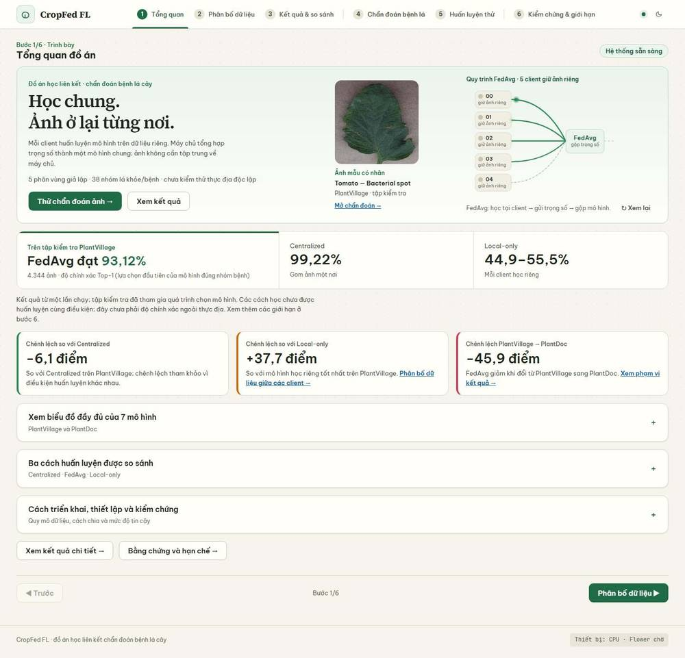
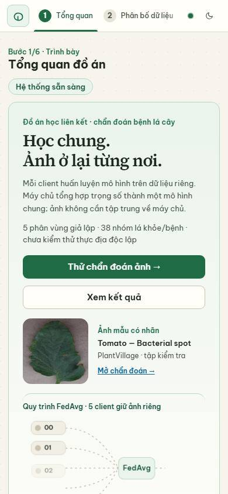

**Phép thử 30 giây.** Người xem mới trả lời được: đồ án làm gì (chẩn đoán bệnh lá), FL hoạt động ra sao (client huấn luyện, máy chủ gộp trọng số, ảnh ở lại), nên đi đâu tiếp (hai nút). **Chưa trả lời được:** đóng góp của đồ án là gì, vì sao chọn FedAvg.

| ID | Loại | P | Vấn đề | Ảnh hưởng | Đề xuất |
|---|---|---|---|---|---|
| B1-1 | U | P2 | Hero không nêu câu hỏi nghiên cứu hay đóng góp; "vì sao FedAvg" chỉ ngầm qua ba chỉ số | Hội đồng phải tự suy ra mục tiêu | Thêm một dòng dưới hero, ví dụ: "Khi dữ liệu bệnh lá phân tán và lệch giữa 5 client, FedAvg đạt gần Centralized đến đâu và hơn mô hình học riêng bao nhiêu?" |
| B1-2 | U | P1 | Dòng "Tiến độ nghiệm thu: 19/22 hạng mục đã xong" dựa trên báo cáo cũ (xem B6-1, B6-2) | Phát biểu về trạng thái kiểm chứng có thể không còn đúng | Sửa theo D3–D5 |
| B1-3 | U | P2 | Ba thẻ chênh lệch ghi "điểm"; tab Kết quả ghi "điểm phần trăm" | Dễ hiểu là điểm số, không phải điểm phần trăm | "−6,1 điểm phần trăm" (D40) |
| B1-4 | U | P2 | Ở 390 px thanh bước chỉ lộ "Tổng quan" và "Phân bố…"; bước 3–6 nằm ngoài, không có dấu hiệu cuộn | Người dùng điện thoại không thấy toàn bộ cấu trúc | Thêm dấu mờ ở mép phải hoặc hiện "1/6" cố định cạnh thanh |
| B1-5 | X | P3 | Chữ 9,5 px ("giữ ảnh riêng") và 11 px (số client) trong sơ đồ FedAvg | Không đọc được khi chiếu | Tối thiểu 12 px; có thể bỏ dòng phụ trong sơ đồ |
| B1-6 | U | P3 | Liên kết trong thẻ cao 16–18 px ở 390 px (< 24 px của WCAG 2.2 AA) | Khó chạm | Tăng `padding` vùng chạm |
| B1-7 | U | P3 | "Các con số này đáng tin tới đâu?" — câu hỏi tu từ; "nơi" và "client" dùng lẫn | Giọng không thống nhất | D6, D41 |

### B.2 Dữ liệu phân tán

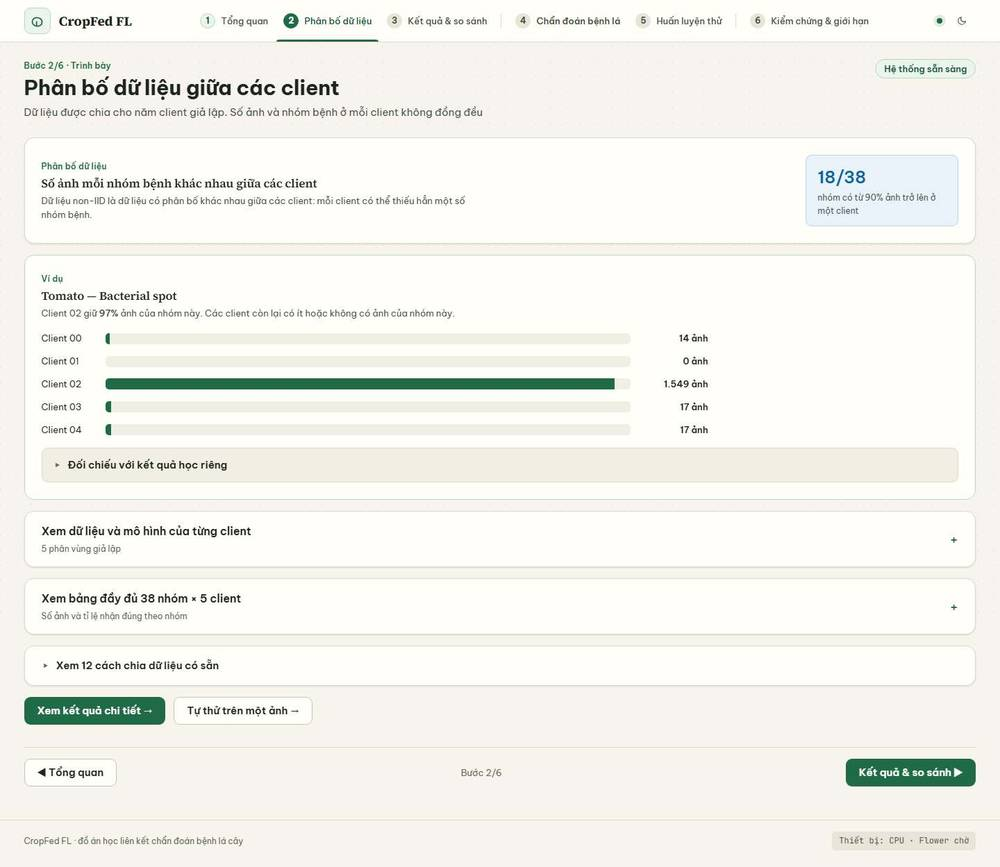

Số liệu chính xác (18/38; 97%; 1.549 ảnh; các client khác 0–17 ảnh) và được tính từ dữ liệu, không viết cứng.

| ID | Loại | P | Vấn đề | Ảnh hưởng | Đề xuất |
|---|---|---|---|---|---|
| B2-1 | U | P2 | Ví dụ chỉ nêu tỉ lệ nhận đúng của 4 client **không** giữ ảnh (đều 0%) và bỏ sót client giữ 97% ảnh. Dữ liệu có sẵn: Local 02 nhận đúng 99,4%, FedAvg 81,4%, Centralized 98,3% | Mất ý tương phản mạnh nhất; người đọc không thấy rằng học riêng tốt khi có dữ liệu | Thêm vào D10 |
| B2-2 | U | P3 | Dòng nhãn "Phân bố dữ liệu" lặp lại tiêu đề trang | Thừa | D9 |
| B2-3 | U | P3 | "Tổng 37.238 ảnh train" (tiếng Anh xen vào) | Không thống nhất | D11 |

### B.3 Kết quả và so sánh

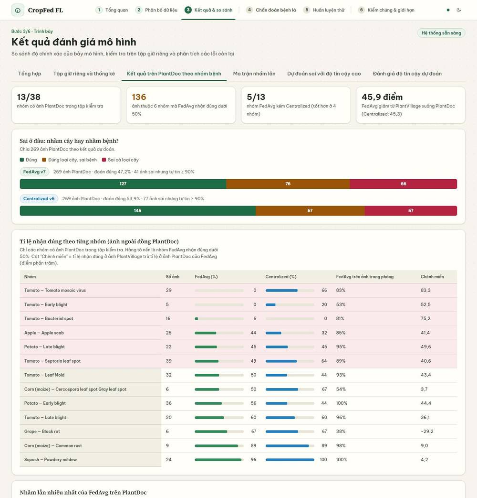
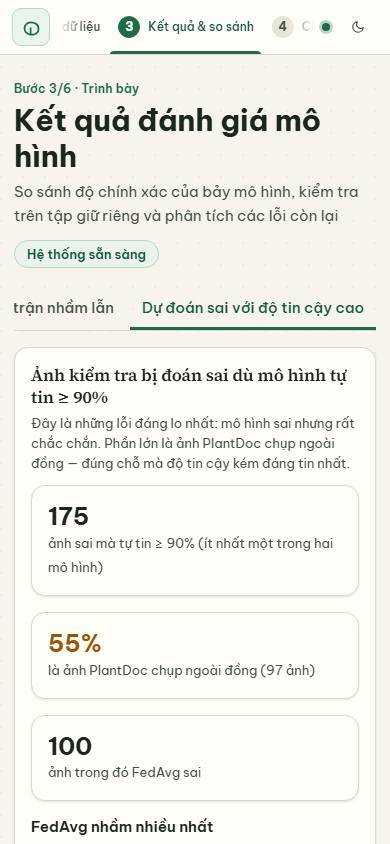

Có kết luận trước bảng; phạm vi và giới hạn đi kèm; bộ lọc, "Xem thêm 20 ảnh" và trạng thái "Không có ảnh khớp bộ lọc" hoạt động.

| ID | Loại | P | Vấn đề | Ảnh hưởng | Đề xuất |
|---|---|---|---|---|---|
| B3-1 | U | P2 | Khối "Nguồn dữ liệu" hiện mã nội bộ nguyên văn: `mixed_pv_pd_v3_pretrained_seed42_validation`, `published validation_comparison.csv; no local image release`, `published_artifact_hash_verified_not_locally_reevaluated` | Người không phải lập trình viên không hiểu mức bằng chứng | Dịch sang câu tiếng Việt, giữ mã làm chú thích (D20) |
| B3-2 | U | P2 | Đoạn "Mục đích của tập giữ riêng" ~110 từ; đoạn so sánh theo cặp ~84 từ chứa McNemar, Bonferroni, bootstrap không giải nghĩa | Khó đọc; hội đồng cần phải hỏi lại | Tách thành 3–4 gạch đầu dòng và một dòng chú giải thuật ngữ (D18, D19) |
| B3-3 | U | P2 | "Tự tin" và "độ tin cậy" dùng lẫn: tab ghi "độ tin cậy", nội dung ghi "mô hình tự tin ≥ 90%" | Nhân hóa mô hình; thuật ngữ không đồng nhất | Thống nhất "xác suất dự đoán" (D13, D14) |
| B3-4 | U | P3 | "Chênh miền", "legacy", "release đã ghim", "bị thổi phồng", "Sai ở đâu: nhầm cây hay nhầm bệnh?" | Văn phong không đồng đều | D15–D17, D21, D42 |
| B3-5 | U | P3 | "So sánh theo cặp trên cùng ảnh" xuất hiện hai lần liền nhau (tóm tắt và tiêu đề) | Thừa | D18 |
| B3-6 | X | P3 | Tab Lỗi ở 390 px dài 8.549 px (20 thẻ một cột); ma trận nhầm lẫn có 8,8% chữ nhỏ hơn 12 px | Cuộn dài; chữ nhỏ khi chiếu | Bố cục 2 cột ≥ 360 px; chữ ma trận ≥ 12 px |

### B.4 Chẩn đoán

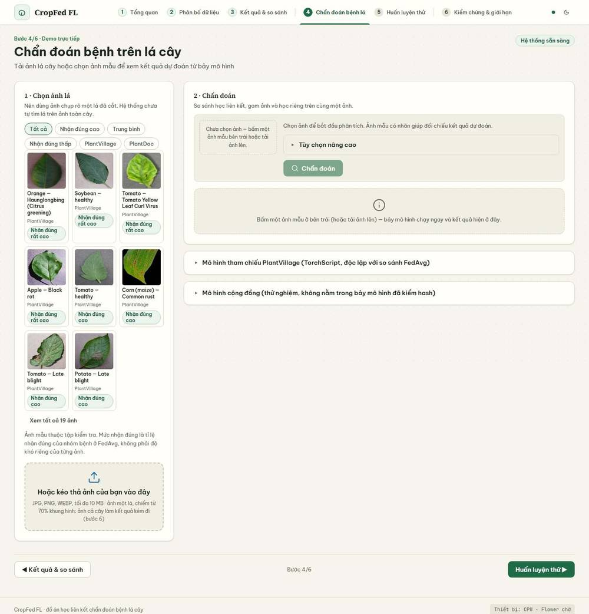
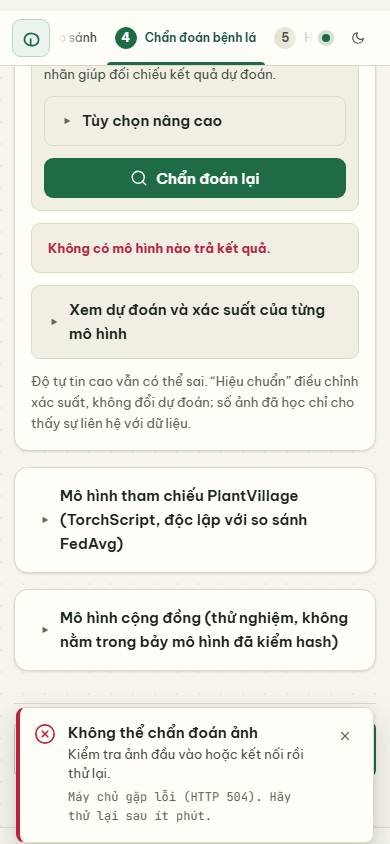

Kết quả chính (FedAvg v7) đứng đầu, có đối chiếu x/7 và lời nhắc "độ tin cậy không phải xác suất đúng". Ảnh mẫu → kết quả trong khoảng 1–3 giây (local). Các tình huống lỗi được kiểm: xem mục C.3 phần chẩn đoán.

| ID | Loại | P | Vấn đề | Ảnh hưởng | Đề xuất |
|---|---|---|---|---|---|
| B4-1 | X | P2 | Khi có kết quả, không có vùng `aria-live` nào thông báo (danh sách live region không có `#diag-summary`) | Người dùng đọc màn hình không biết kết quả đã xuất hiện | Đặt `role="status"` cho `#diag-summary` hoặc đẩy câu kết luận vào `#stage-tag` |
| B4-2 | U | P3 | Trạng thái rỗng hiện hai thông báo trùng nghĩa và một nút bị khóa; không nêu rõ nút "Chẩn đoán" chỉ để chạy lại | Rối khi mới vào | Giữ một thông báo; nút ghi "Chẩn đoán lại" khi có ảnh |
| B4-3 | U | P3 | Bộ lọc gộp hai nhóm không nhãn (mức nhận đúng và nguồn); chip "Trung bình" thiếu tiền tố "Nhận đúng" (do đợt sửa chữ ngày 14/10) | Không biết là hai nhóm lọc | Thêm nhãn nhóm hoặc đổi thành "Nhận đúng trung bình" |
| B4-4 | U | P3 | "Centralized + 1", "Mô hình so với Centralized" khó hiểu | Người mới không biết chọn gì | D32 |
| B4-5 | S | P3 | Chọn nhanh 5 ảnh gửi 5 yêu cầu 7 mô hình; phía máy chủ không bị hủy dù trình duyệt bỏ kết quả | Tải thừa trên máy yếu | Debounce 300 ms hoặc hủy phía máy chủ khi client ngắt |
| B4-6 | S | P3 | Nút "PlantVillage" và "mô hình cộng đồng" được bật lại khi đổi ảnh dù yêu cầu cũ chưa xong (kết quả cũ được bỏ đúng) | Có thể gửi chồng | Hủy yêu cầu cũ bằng `AbortController` |

### B.5 Huấn luyện và mô phỏng

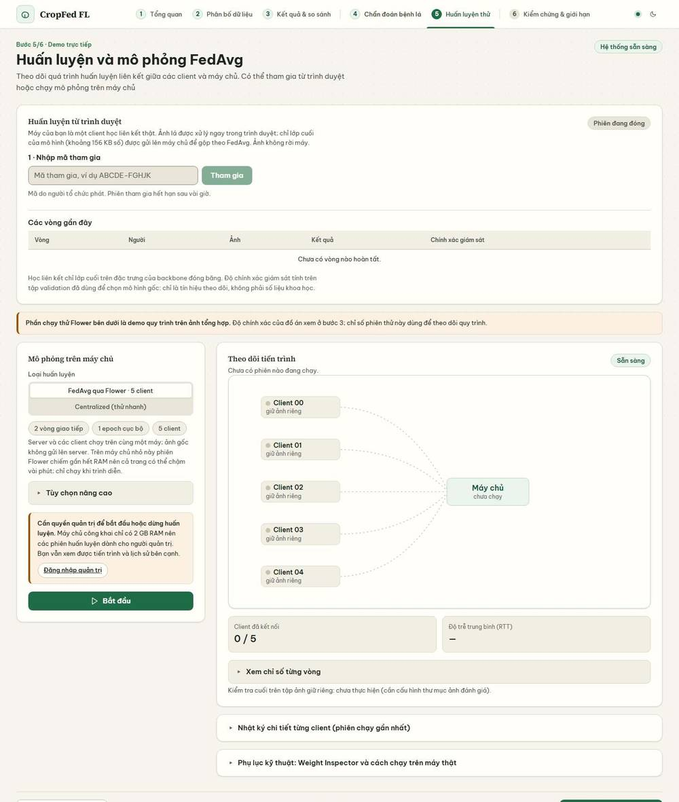
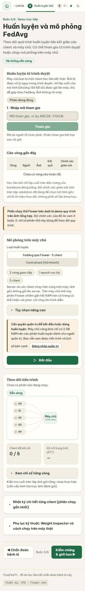

| ID | Loại | P | Vấn đề | Ảnh hưởng | Đề xuất |
|---|---|---|---|---|---|
| B5-1 | X | P1 | Khung cổng ghi "Máy chủ công khai chỉ có 2 GB RAM" và dòng phụ "Trên máy chủ nhỏ này phiên Flower chiếm gần hết RAM…". Production hiện là VM 64 GB | Phát biểu sai về hạ tầng | D1, D2 |
| B5-2 | U | P1 | Phiên đóng là mặc định: khách chỉ thấy biểu mẫu khóa và huy hiệu "Phiên đang đóng". Câu giải thích nằm trong khối bị ẩn; không có hướng dẫn "làm sao để thử" | Hội đồng không trải nghiệm được tính năng nổi bật nhất | D29 + khối "Quy trình 4 bước" tĩnh (C.4) |
| B5-3 | X | P2 | Khi chạy Flower, huy hiệu cố định "Đang giao tiếp (vòng 0/?)" và bảng tiến độ trống cả phiên; sau khi xong thành "Sẵn sàng" và bảng vẫn trống. Nguyên nhân: `live_progress` của engine network luôn `[]` (`training.py:426`; chỉ simulation/Centralized ghi bước ở dòng 200, 289) | Người trình diễn không thấy "vòng 1/2 xong" | Hiển thị số vòng từ `network_processes.round_completed` / `rounds` |
| B5-4 | U | P2 | Hai nhóm người dùng (người tham gia và quản trị) không được gắn nhãn đối tượng | Khách không biết khu nào dành cho mình | Thêm nhãn "Dành cho người tham gia" và "Dành cho quản trị viên" (C.4) |
| B5-5 | U | P3 | Nhãn tiếng Anh trong "Tùy chọn nâng cao": Engine, Validator, Held-out evaluation root, Observe/Reject | Không thống nhất | D33 |
| B5-6 | U | P3 | Phụ lục kỹ thuật hiện lệnh Windows `.\.venv\Scripts\python.exe -m web.app` trên máy chủ Linux công khai | Gây nhầm lẫn | D37 |
| B5-7 | U | P2 | "Học liên kết chỉ lớp cuối trên đặc trưng của backbone đóng băng…" và câu tương tự | Người mới không hiểu | D22 |
| B5-8 | U | P3 | Chân trang "Flower chờ" | Không rõ nghĩa | D36 |

### B.6 Bằng chứng và hạn chế

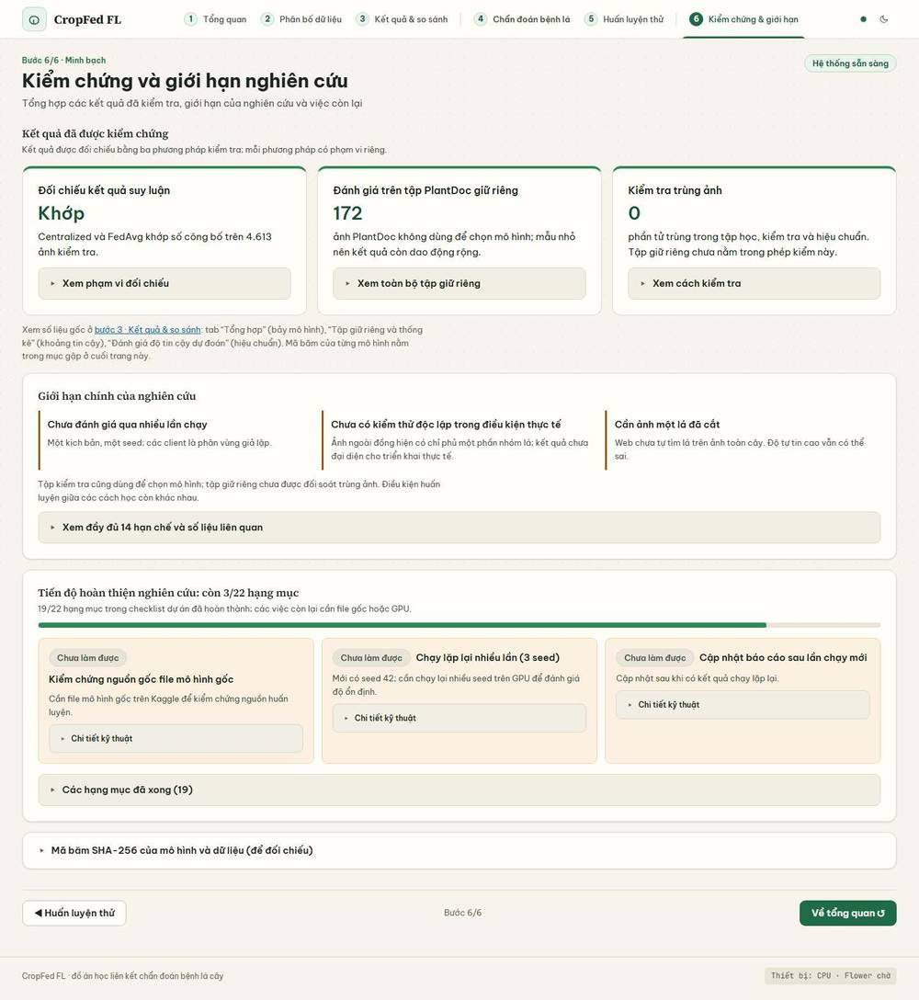

Phần mạnh nhất của website: 14 hạn chế đầy đủ, có số liệu; ba phép kiểm có phạm vi riêng; mã băm; kiểm tra trùng ảnh nói rõ tập giữ riêng chưa nằm trong phép kiểm này.

| ID | Loại | P | Vấn đề | Ảnh hưởng | Đề xuất |
|---|---|---|---|---|---|
| B6-1 | X | P1 | Mục "Full tests pass trên mã nguồn hiện tại" ghi `technical_acceptance=pass lúc 2026-10-12T22:16:09 … trên đúng mã nguồn hiện tại`, và "Release sạch (mọi gate kỹ thuật XONG)". Mã đang chạy đã đổi từ sau thời điểm đó (đợt cộng đồng và giao diện ngày 13–14/10). Chạy `scripts/update_status.py` ở bản hiện tại cho kết quả "không còn khớp mã nguồn hiện tại" | Phát biểu kiểm chứng không còn đúng | Chạy `update_status.py --full-gates` trên máy có `flwr`, triển khai lại `artifacts/status_report.json`; trước đó ghi rõ ngày và "chưa chạy lại" (D3) |
| B6-2 | U | P1 | "Tiến độ hoàn thiện nghiên cứu: còn 3/22" — 19 mục đã xong chủ yếu là việc kỹ thuật (tách router, dọn tài liệu, khai báo dependency, không hardcode đường dẫn); 3 mục còn lại là việc nghiên cứu then chốt (kiểm chứng nguồn mô hình gốc, chạy nhiều seed, cập nhật báo cáo) | Thanh 86% gợi ý đồ án gần xong; tiêu đề "tiến độ nghiên cứu" làm điều này nặng hơn | Tách hai danh sách và sửa tiêu đề (D4, D5) |
| B6-3 | U | P3 | "Chi tiết kỹ thuật" hiện lệnh PowerShell nội bộ và `provenance=unverified; lỗi: ['fedavg_checkpoint_missing', …]` | Nhiễu với hội đồng | Gom vào mục gập "Dành cho người vận hành" |
| B6-4 | U | P2 | 13 phần tử tương tác nhỏ hơn 24 px ở 390 px (`summary` 19 px, nút "sao chép" 20 px, liên kết 16 px) | Khó chạm | Tăng chiều cao tối thiểu 24 px |
| B6-5 | U | P3 | Không có mục "Hướng phát triển" riêng; không phân biệt rõ "kết quả đã kiểm chứng / kết quả tham khảo / chưa làm" bằng nhãn nhất quán | Yêu cầu của hội đồng thường có mục này | Thêm 3–4 gạch đầu dòng "Hướng phát triển" dựa trên 3 việc còn lại và các hạn chế |

### B.7 Trang quản trị `/quan-tri`

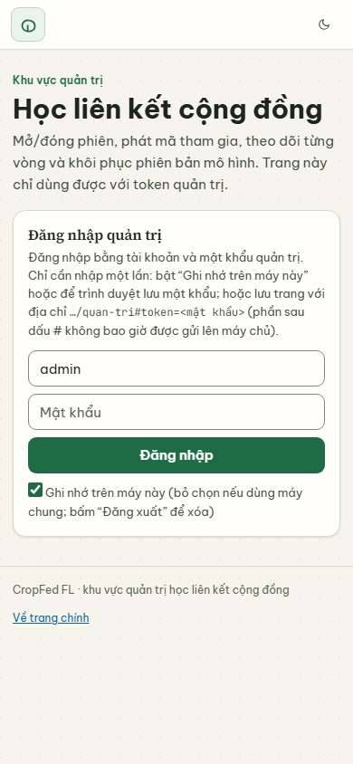
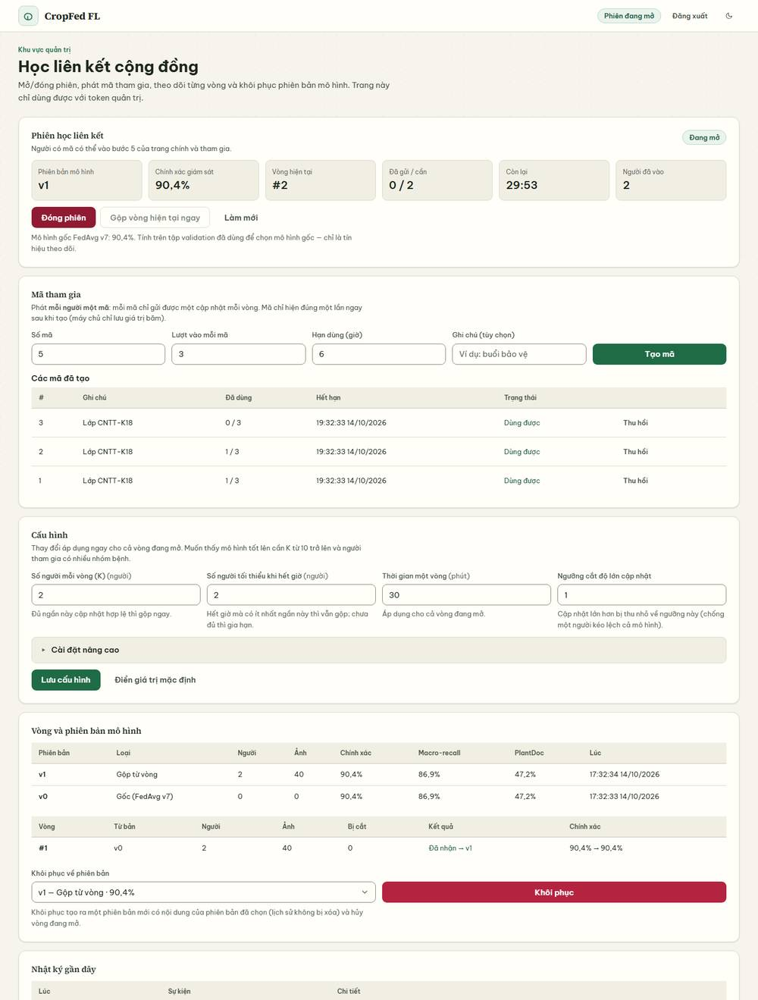

Đăng nhập sai báo "Tài khoản hoặc mật khẩu không đúng."; bố cục không tràn ngang ở 390–1920 px; E2E của repo kiểm 23 thao tác quản trị đều đạt.

| ID | Loại | P | Vấn đề | Ảnh hưởng | Đề xuất |
|---|---|---|---|---|---|
| B7-1 | U | P3 | "Trang này chỉ dùng được với token quản trị" trong khi hệ thống dùng tài khoản và mật khẩu | Lỗi thời | D34 |
| B7-2 | U | P3 | Nhật ký gần đây hiện khóa kỹ thuật (`round_id`, `parent_version`, `norm: 0.3945`, `ip`) và dấu thập phân kiểu Anh | Khó đọc | D35 |
| B7-3 | X | P3 | WebKit báo 8 lỗi console CSP (`style-src`) trên `/quan-tri`; giao diện hiển thị bình thường | Nhiễu console | Kiểm tra `style=` nội tuyến hoặc thuộc tính style động |
| B7-4 | U | P2 | Admin thấy địa chỉ IP người tham gia trong nhật ký; người tham gia không được thông báo (xem C.5) | Minh bạch dữ liệu cá nhân | Thêm một dòng vào khối "Dữ liệu nào được gửi đi" |

### B.8 Vấn đề xuyên suốt

| ID | Loại | P | Vấn đề | Bằng chứng | Đề xuất |
|---|---|---|---|---|---|
| X1 | X | P2 | `heading-order`: tiêu đề khối (`h3`) đứng ngay dưới `h1`, bỏ qua `h2` | axe, 40 trạng thái | Đổi `h3.panel-title` thành `h2` hoặc thêm `h2` ẩn cho từng khối |
| X2 | S | P3 | axe `skip-link` báo 18 trạng thái: liên kết điều hướng `#tong-quan`… được coi là skip link nhưng không có phần tử đích | axe | Dùng `data-route` thay `href="#…"` hoặc gắn `id` đích |
| X3 | U | P2 | Mỗi tab đang tham gia gọi ~29 yêu cầu/phút khi nhàn rỗi: `/api/status` 8 lần/35 s, `/round` 7 lần/35 s, kèm `/status` và `/history` | J4 | Giãn `/api/status` khi tab ẩn hoặc nhàn rỗi; dùng ETag |
| X4 | X | P2 | WebKit (bản Playwright): Client FL báo "chưa hỗ trợ OffscreenCanvas" **sau khi** đã nhập mã tham gia | J10 | Kiểm tra tính năng ngay khi mở bước 5 (C.4); kiểm trên Safari thật |
| X5 | U | P3 | Nhãn thanh bước, tiêu đề trang và nút CTA chưa thống nhất: "Huấn luyện thử" / "Huấn luyện và mô phỏng FedAvg"; "Chẩn đoán bệnh lá" / "Chẩn đoán bệnh trên lá cây"; CTA "Bằng chứng và hạn chế →" khi nhãn là "Kiểm chứng & giới hạn" | Đợt sửa chữ 14/10 chưa đổi hết | D7, D8 |

---

## C. Review riêng Client FL

### C.1 Hành trình hiện tại và cái người dùng thấy

Kiểm ở 390 px trên máy chủ local, mã trùng production. Chi tiết số đo ở phụ lục 2.

| # | Bước | Người dùng thấy | Đánh giá |
|---|---|---|---|
| 1 | Nhập mã | Huy hiệu "Đang mở/Phiên đang đóng"; ô mã; nút "Tham gia". Mã sai: toast "Mã tham gia không đúng, đã hết hạn hoặc đã hết lượt dùng." | Tốt khi phiên mở. Khi **đóng**: ô và nút bị khóa, câu giải thích bị ẩn (B5-2) |
| 2 | Tham gia | Huy hiệu "Đã tham gia", 4 chỉ số: vòng, người đã gửi, còn lại, phiên bản | Tốt |
| 3 | Chọn ảnh, gán nhãn | Dòng đếm: "3 ảnh · đã chọn nhóm 0 ảnh (0 nhóm) · cần ít nhất 5 ảnh có nhóm." | Tốt: có chỉ báo tối thiểu và lý do nút khóa |
| 4 | Kiểm đủ điều kiện | Nút "Huấn luyện" bật khi ≥ 5 ảnh có nhóm. Ảnh hỏng chỉ lộ lúc huấn luyện: "Chỉ 4 ảnh dùng được; cần ít nhất 5 ảnh có nhóm và đọc được." | Chấp nhận được; nên phát hiện sớm (C.4) |
| 5 | Huấn luyện cục bộ | Chuỗi nhãn: "Đang chuẩn bị…" → "Đang tải mô hình đặc trưng (x / 6,1 MB)" → "Đang khởi động mô hình" → "Đang trích đặc trưng (i / n)" → "Đang huấn luyện lớp cuối (e / N epoch)" | Tốt, nhưng bước "khởi động" không có tiến độ (C.3) |
| 6 | Theo dõi vòng | KPI "#1 · 1/3 · 29:54 · v0"; đếm ngược cục bộ | Tốt |
| 7 | Gửi cập nhật | Nút "Gửi trọng số lên máy chủ" | Tốt |
| 8 | Xác nhận | "Đã gửi. Máy chủ đã nhận cập nhật của bạn (0,012). Vòng #1: đã có 1 / 3 người. Vòng sẽ gộp khi đủ người hoặc hết giờ." | Rõ; số "(0,012)" không có nhãn |
| 9 | Trạng thái tổng hợp | Khi đủ người, chỉ số đổi sang "#2 · 0/3 · v1" và bảng lịch sử thêm một dòng. **Không có thông báo** "vòng của bạn đã được gộp vào v1" | Thiếu (C.2) |
| 10 | Rời phiên / hết hạn | "Rời phiên" cần bấm hai lần; token hết hạn: toast "Đã rời phiên — Phiên tham gia đã hết hạn. Hãy nhập lại mã." | Tốt |

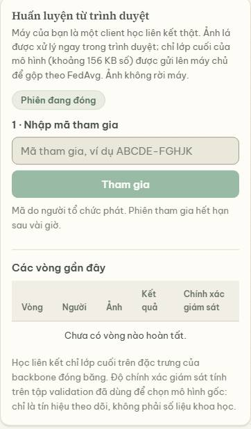
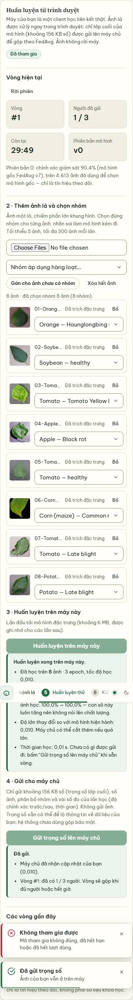

### C.2 Các bước gây khó hiểu

1. **Nút "Huấn luyện" khóa sau khi tải lại trang mà không có lý do** *(X, P1)*. Tải lại sau khi đã gửi: ảnh mất, token còn. Thêm ảnh và gán nhãn đủ → nút vẫn khóa; dòng ghi chú bên dưới chỉ là "Lần đầu tải mô hình đặc trưng…". Người dùng không biết rằng mã của mình đã gửi cho vòng này.
2. **Không có thông báo vòng đã gộp** *(U, P1)*. Phân biệt "đã huấn luyện / đã gửi / đã nhận" có; "đã gộp" chỉ thể hiện qua chỉ số và bảng lịch sử, không nêu "bản cập nhật của bạn nằm trong vòng #1 → v1".
3. **Thông báo sai khi mất phản hồi** *(X, P1)*. Máy chủ đã nhận cập nhật (chỉ số "1 / 3"), nhưng ô kết quả báo "Máy chủ không nhận cập nhật. Không kết nối được máy chủ…". Nút Gửi tự khóa theo lần thăm dò kế, nên người dùng không có đường thử lại và cũng không biết là không cần thử lại.
4. **Phục hồi sau lỗi worker thất bại** *(X, P1)*. Sau sự kiện lỗi của worker, bấm huấn luyện lại báo "Chưa huấn luyện được. Còn 6 ảnh chưa được trích đặc trưng." Nút vẫn bật, cùng lỗi lặp lại. Cách thoát duy nhất: xóa hết ảnh và thêm lại.
5. **Phiên đóng nhưng giải thích bị ẩn** *(X, P1)*. Câu "Phiên đang đóng: người tổ chức chưa mở hoặc đã đóng…" nằm trong khối chưa hiển thị; khách chỉ thấy huy hiệu.
6. **Liên kết `?code=` khi phiên đóng** *(X, P2)*. Toast "Đã điền sẵn mã tham gia — Bấm “Tham gia” để vào phiên." trong khi nút "Tham gia" đang khóa.
7. **Sửa nhãn sau khi huấn luyện** *(X, P2)*. Nút Gửi tự khóa nhưng khung "Huấn luyện xong trên máy này…" vẫn hiện nguyên văn, không nói kết quả đã cũ.
8. **Lỗi tải mô hình bằng tiếng Anh** *(X, P2)*. "Chưa huấn luyện được. Failed to fetch."
9. **429 từ nginx** *(X, P2)*. "Máy chủ không nhận cập nhật. Yêu cầu không thành công (HTTP 429)." — không nói "thử lại sau".
10. **Chỉ số nhảy ngược thoáng qua** *(X, P3)*. Phản hồi poll cũ về muộn ghi đè trạng thái mới: "1/3" → "0/3" → "1/3" trong khoảng 1 giây.

### C.3 Các tình huống lỗi và phục hồi (kết quả kiểm)

| Tình huống | Kết quả | Phục hồi |
|---|---|---|
| Mã sai | Toast rõ ràng | Nhập lại |
| Phiên đóng khi đã tham gia | Chỉ số về "—"; ghi chú "Phiên đang đóng…" | Đợi mở lại |
| Vòng đổi giữa chừng (`stale_round`) | "Vòng đã đổi. Vòng này đã đóng trong lúc bạn huấn luyện. Hãy huấn luyện lại trên mô hình mới nhất. Ảnh đã trích đặc trưng nên huấn luyện lại rất nhanh." | **Tốt nhất trong các thông báo lỗi** |
| Gửi trùng (hai tab, cùng token) | "Mã tham gia của bạn đã được dùng để gửi cập nhật cho vòng này. Hãy đợi vòng kế tiếp." (có tiền tố "Máy chủ không nhận cập nhật.") | Chấp nhận được |
| Mất phản hồi khi gửi | Báo "không nhận" trong khi đã nhận | Không có đường thử lại hợp lý (C.2-3) |
| Worker lỗi/treo | Lỗi "Còn N ảnh chưa được trích đặc trưng" lặp lại | Phải xóa và thêm lại ảnh (C.2-4) |
| Không tải được mô hình | "Failed to fetch" | Sau khi mạng về, bấm lại thì chạy (đã kiểm) |
| Ảnh hỏng/định dạng lạ | PDF bị chặn lúc thêm; JPEG hỏng và HEIC giả vào danh sách, gắn "Không đọc được ảnh" khi huấn luyện | Chấp nhận được; nên phát hiện sớm |
| > 25 MB; > 300 ảnh | Toast "to.jpg: lớn hơn 25 MB"; "p300.png: vượt 300 ảnh; …" (liệt kê 5 tên đầu) | Tốt |
| Token hết hạn/không hợp lệ | Toast "Phiên tham gia đã hết hạn. Hãy nhập lại mã." và về biểu mẫu | Tốt |
| Rời phiên khi đang huấn luyện | Không lỗi hiển thị; không có cảnh báo trước | Chấp nhận được |
| Mạng 4G chậm, lần đầu | Tải mô hình 6,1 MB: 30 s, có tiến độ theo MB. Sau đó "Đang khởi động mô hình" 55 s **không có tiến độ** (bộ chạy wasm 11,2 MB; trên production nén còn 3,5 MB) | Cần thanh tiến độ cho bước này |
| Chẩn đoán: PDF, tệp rỗng, > 10 MB, ảnh hỏng, 500, 504, offline | Toast riêng, tiếng Việt, có nguyên nhân | Tốt |

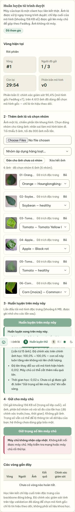
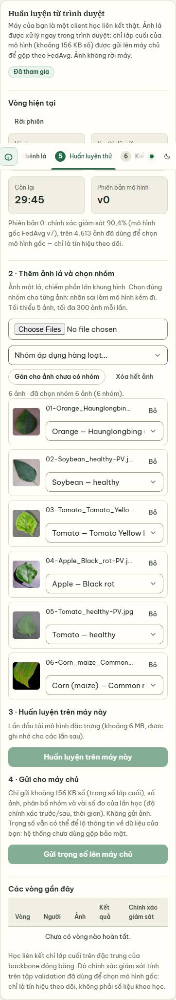
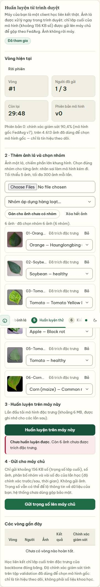
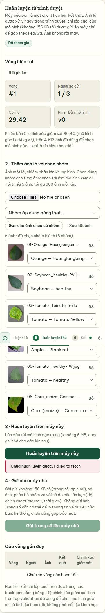
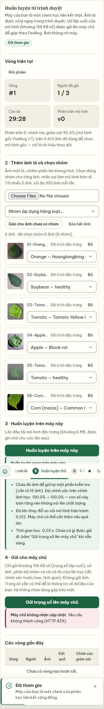
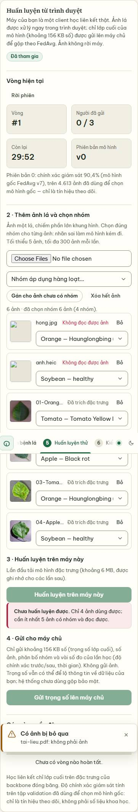
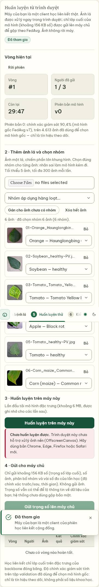

### C.4 Hướng cải thiện quy trình

1. **Một "thanh trạng thái" duy nhất cho người tham gia** gồm bốn cột mốc: *Đã tham gia → Đã huấn luyện → Đã gửi → Đã gộp (v1)*, hiện ở đầu khối. "Đã gộp" bật khi `version` tăng sau khi mã của mình đã gửi; kèm một toast một lần "Cập nhật của bạn đã góp vào phiên bản v1".
2. **Mọi nút khóa phải có một câu lý do ngay dưới nút.** Bảng lý do: phiên đóng · chưa đủ 5 ảnh có nhóm · đã gửi cho vòng này (hãy đợi vòng kế tiếp) · đang xử lý.
3. **Khóa gửi thay cho thông báo "không nhận".** Khi gửi lỗi mạng, hỏi lại trạng thái (`/round` đã có `already_submitted`) trước khi báo; nếu đã nhận thì báo "Máy chủ đã nhận cập nhật của bạn; số liệu sẽ cập nhật sau vài giây".
4. **Khi worker bị đặt lại**, xóa cờ `hasFeature` của các ảnh (hoặc tự trích đặc trưng lại) để lần bấm kế tiếp thành công.
5. **Kiểm tra khả năng của trình duyệt ngay khi mở bước 5** (module worker, `OffscreenCanvas`, `WebAssembly`) và hiển thị cảnh báo trong khối cộng đồng, trước khi người dùng nhập mã.
6. **Bước "Đang khởi động mô hình"** cần thanh tiến độ theo byte của tệp wasm, hoặc tải trước (`<link rel="preload">`) khi người dùng mở khối. Câu "khoảng 6 MB" nên ghi tổng thực tế (~10 MB lần đầu).
7. **Hướng dẫn khi phiên đóng**: thay thế biểu mẫu khóa bằng khối "Cách tham gia" 4 bước (Nhận mã → Nhập mã → Chọn ảnh có nhãn → Huấn luyện và gửi) và một dòng "Phiên hiện đóng; hãy nhờ người tổ chức mở phiên". Đây là chỗ hội đồng sẽ nhìn nhất.
8. **Phát hiện ảnh hỏng sớm**: giải mã nhanh (hoặc `createImageBitmap`) ngay khi thêm; đánh dấu "Không đọc được ảnh" trước khi đến bước huấn luyện.
9. **Thông báo "đã gộp" cho mọi người đã gửi** dựa trên lịch sử (`/history`), không chỉ chỉ số.

### C.5 Dữ liệu nào ở máy, dữ liệu nào gửi đi

Đã đối chiếu mô tả trên giao diện với payload thật bắt được ở trình duyệt:

| Dữ liệu | Ở lại máy | Gửi lên máy chủ |
|---|---|---|
| Ảnh gốc, ảnh đã giải mã, đặc trưng 1024 chiều, nhãn từng ảnh, tập kiểm tra giữ lại | Có | Không |
| Trọng số lớp cuối (≈ 156 KB nhị phân; ~208 KB base64) | — | Có |
| `num_examples`, `label_counts` (38 số, chỉ phần huấn luyện) | — | Có |
| `local`: epochs, lr, batch, n_train, n_holdout, độ chính xác và loss trước/sau, thời gian huấn luyện | — | Có |
| `round_id`, `parent_sha`, `dp_applied`, token | — | Có |
| Địa chỉ IP, thời điểm tham gia | — | Máy chủ ghi khi `join` (`community_store.py:384–393`); admin thấy trong nhật ký |

Giao diện nói đúng về ảnh ("Không gửi ảnh") và về trọng số ("vẫn có thể để lộ thông tin… chưa dùng gộp bảo mật"); **chưa nói** về việc máy chủ ghi IP. Nên thêm một câu.
Các số `loss`, `epochs`, `lr`, `batch` nằm trong "vài số đo của lần học" — đúng nhưng nên liệt kê.

---

## D. Nội dung — các câu cần sửa

Giữ nguyên: tên bệnh (theo quy tắc đã chốt), số liệu, câu nhận diện "Học chung. Ảnh ở lại từng nơi.".
Vị trí = tệp:dòng ở commit `f685d9ddc`.

| ID | Vị trí | Nội dung gốc | Vấn đề | Thay thế | Lý do |
|---|---|---|---|---|---|
| D1 | `index.html:514` | "Máy chủ công khai chỉ có 2 GB RAM nên các phiên huấn luyện dành cho người quản trị." | Sai với máy hiện tại (64 GB) | "Huấn luyện chiếm nhiều bộ nhớ và CPU của máy chủ công khai nên chỉ quản trị viên được bắt đầu hoặc dừng phiên." | Không gắn với cấu hình máy |
| D2 | `training.js:358` | "Trên máy chủ nhỏ này phiên Flower chiếm gần hết RAM nên cả trang có thể chậm vài phút; chỉ chạy khi trình diễn." | Phụ thuộc máy | "Phiên Flower chạy năm tiến trình client cùng lúc nên tốn tài nguyên; chỉ chạy khi cần trình diễn." | Đúng với mọi máy |
| D3 | `artifacts/status_report.json` ← `scripts/update_status.py:326–335` | "technical_acceptance=pass lúc 2026-10-12T22:16:09 … trên đúng mã nguồn hiện tại" | Khẳng định đã cũ | Chạy lại `--full-gates`; nếu chưa kịp: "Kiểm thử đạt lúc 12/10/2026 22:16; chưa chạy lại sau thay đổi ngày 13–14/10." | Phát biểu kiểm chứng phải đúng thời điểm |
| D4 | `overview.js:286` | "Tiến độ nghiệm thu: 19/22 hạng mục đã xong; 3 hạng mục còn lại cần file mô hình gốc hoặc máy huấn luyện GPU — xem ở bước 6." | Trộn việc kỹ thuật với việc nghiên cứu | "Danh mục kiểm tra dự án: 19/22 hạng mục kỹ thuật đã xong. Ba việc nghiên cứu còn lại cần file mô hình gốc hoặc GPU — xem bước 6." | Không làm tiến độ nghiên cứu trông cao hơn thực tế |
| D5 | `evidence.js:130` | "Tiến độ hoàn thiện nghiên cứu: còn 3/22 hạng mục" | Như D4 | Hai khối: "Việc nghiên cứu còn lại (3)" và "Hạng mục kỹ thuật đã xong (19)" | Như D4 |
| D6 | `overview.js:284` | "Các con số này đáng tin tới đâu?" | Câu hỏi tu từ | "Mức độ kiểm chứng của các con số" | Tiêu đề mô tả |
| D7 | `overview.js:292` | Nút "Bằng chứng và hạn chế →" | Lệch nhãn bước ("Kiểm chứng & giới hạn") | "Kiểm chứng và giới hạn →" | Nhất quán |
| D8 | `router.js:25–26, 31–32` | Nhãn "Huấn luyện thử"; "Chẩn đoán bệnh lá" so với tiêu đề "Huấn luyện và mô phỏng FedAvg"; "Chẩn đoán bệnh trên lá cây" | Nhãn ≠ tiêu đề | Nhãn "Huấn luyện & mô phỏng"; "Chẩn đoán bệnh lá cây". Sửa cả `index.html:71–85` (có test đối chiếu nhãn) | Nhất quán |
| D9 | `noniid.js` (khối giới thiệu) | Dòng nhãn "Phân bố dữ liệu" | Lặp tiêu đề trang | Bỏ, hoặc "Khái niệm: non-IID" | Giảm thừa |
| D10 | `noniid.js:225` | "Tỉ lệ nhận đúng nhóm này: Local 00: 0% · Local 01: 0% · Local 03: 0% · Local 04: 0%." | Bỏ sót client giữ nhiều ảnh nhất | "…: Local 02 (giữ 97% ảnh): 99,4% · Local 00, 01, 03, 04: 0% · FedAvg: 81,4% · Centralized: 98,3%." (lấy từ `reeval.pv_recall`) | Đủ tương phản; không cắt chọn số |
| D11 | `noniid.js:183` | "Tổng 37.238 ảnh train." | Tiếng Anh xen vào | "Tổng 37.238 ảnh huấn luyện." | Nhất quán |
| D12 | `results.js:642` | "Đây là những lỗi đáng lo nhất: mô hình sai nhưng rất chắc chắn. Phần lớn là ảnh PlantDoc chụp ngoài đồng — đúng chỗ mà độ tin cậy kém đáng tin nhất." | Nhân hóa, cảm xúc | "Đây là các dự đoán sai có xác suất cao nhất. Phần lớn là ảnh PlantDoc chụp ngoài đồng, nơi xác suất dự đoán lệch xa nhất so với độ chính xác thực." | Trung tính |
| D13 | `results.js:641, 197` | "…bị đoán sai dù mô hình tự tin ≥ 90%"; "41 ảnh sai nhưng tự tin ≥ 90%" | "Tự tin" nhân hóa | "…bị dự đoán sai với xác suất ≥ 90%"; "41 ảnh sai với xác suất ≥ 90%" | Thống nhất thuật ngữ |
| D14 | `index.html:287`; `evidence.js:10, 264` | "Độ tự tin cao vẫn có thể sai."; "Độ tự tin chỉ được chỉnh một phần" | Như D13 | "Xác suất dự đoán cao vẫn có thể sai."; "Xác suất dự đoán chỉ được hiệu chuẩn một phần" | Như D13 |
| D15 | `results.js:235` | "Sai ở đâu: nhầm cây hay nhầm bệnh?" | Câu hỏi tu từ | "Phân loại lỗi: sai loại cây hoặc sai bệnh" | Tiêu đề mô tả |
| D16 | `results.js:243,246` | Cột "Chênh miền" | Thuật ngữ chưa giải thích | "Chênh lệch miền (PlantVillage − PlantDoc)" | Rõ nghĩa |
| D17 | `results.js:499–500` | "Ảnh nghi chụp lại cùng một lá ảnh hưởng thế nào?" | Câu hỏi tu từ | "Độ nhạy với ảnh nghi chụp lại cùng một lá" | Tiêu đề mô tả |
| D18 | `results.js:492` | Tóm tắt và tiêu đề trùng; đoạn 84 từ chứa McNemar, Bonferroni, bootstrap | Dài, thuật ngữ | Tóm tắt "So sánh theo cặp"; 3 câu ngắn + chú giải: "McNemar: kiểm định hai mô hình trên cùng ảnh. Bootstrap theo cụm: ước lượng khoảng dao động khi nhiều ảnh cùng cảnh hoặc cùng lá." | Dễ đọc |
| D19 | `results.js:482–484` | Đoạn "Mục đích của tập giữ riêng" ~110 từ | Dài | 3 gạch đầu dòng: (1) mô hình được chọn trên tập kiểm tra → số có thể đẹp hơn thực tế; (2) tập giữ riêng không dùng để chọn; (3) chưa được đối soát trùng ảnh | Dễ quét |
| D20 | `results.js:89–93` (hiển thị `metrics_source`, `evidence_level` từ `demo_evidence.py:163`) | "published validation_comparison.csv; no local image release; mức bằng chứng published_artifact_hash_verified_not_locally_reevaluated" | Mã nội bộ | "Bảng validation_comparison.csv đã công bố; chưa có ảnh gốc trên máy chủ để chấm lại trực tiếp. Mức bằng chứng: tệp công bố đã kiểm mã băm." (ánh xạ ở frontend, không đổi API) | Người đọc hiểu mức bằng chứng |
| D21 | `overview.js:45,266`; `results.js:483`; `evidence.js:33,228` | "bộ chẩn đoán legacy" | Tiếng Anh | "bộ chẩn đoán có sẵn của bộ dữ liệu (legacy)" ở lần đầu, sau đó "tập giữ riêng" | Giải thích một lần |
| D22 | `community_store.py:587` (`caveat`) | "Học liên kết chỉ lớp cuối trên đặc trưng của backbone đóng băng. Độ chính xác giám sát tính trên tập validation đã dùng để chọn mô hình gốc: chỉ là tín hiệu theo dõi, không phải số liệu khoa học." | Thuật ngữ dày | "Người tham gia chỉ huấn luyện lớp phân loại cuối; phần trích đặc trưng giữ nguyên. “Độ chính xác giám sát” tính trên tập kiểm tra đã dùng để chọn mô hình gốc, nên chỉ để theo dõi, không phải kết quả khoa học." | Dễ hiểu |
| D23 | `index.html:394`; `admin.html:85` | "Chính xác giám sát" | Thiếu danh từ | "Độ chính xác giám sát" | Ngữ pháp |
| D24 | `community.js:565–577` | "Máy chủ không nhận cập nhật. Không kết nối được máy chủ…" | Sai khi máy chủ đã nhận | "Chưa nhận được phản hồi từ máy chủ. Cập nhật có thể đã được lưu; hãy xem chỉ số “Người đã gửi” và đừng gửi lại ngay." | Đúng thực tế |
| D25 | `community.js:211, 295–296`; `community-worker.js:150` | "Chưa huấn luyện được. Còn 6 ảnh chưa được trích đặc trưng." | Ngõ cụt | Sau khi worker bị đặt lại: tự trích đặc trưng lại; nếu cần thông báo: "Tiến trình xử lý ảnh vừa được khởi động lại. Bấm Huấn luyện để chạy lại." | Có đường ra |
| D26 | `community-worker.js:70–73`; `community.js:511` | "Chưa huấn luyện được. Failed to fetch." | Tiếng Anh thô | "Không tải được mô hình đặc trưng. Hãy kiểm tra kết nối mạng rồi bấm Huấn luyện lại." | Việt hóa lỗi mạng |
| D27 | `community.js:548` | "Máy chủ đã nhận cập nhật của bạn (0,012)." | Số không nhãn | "…(độ lớn thay đổi 0,012)." hoặc bỏ | Rõ nghĩa |
| D28 | `index.html:368`; `community.js:13` | "Lần đầu tải mô hình đặc trưng (khoảng 6 MB, được ghi nhớ cho các lần sau)." | Thấp hơn thực tế (~10 MB: 6,1 MB + 3,5 MB nén) và hiện mãi sau khi đã có | "Lần đầu cần tải khoảng 10 MB (mô hình 6 MB và bộ chạy 3,5 MB nén); trình duyệt ghi nhớ cho các lần sau." Ẩn khi đã có bộ nhớ đệm | Đúng; không nhiễu |
| D29 | `community.js:112`; `index.html:368` | Câu "Phiên đang đóng…" nằm trong khối ẩn | Không thấy | Đặt dưới ô mã: "Phiên hiện đang đóng. Hãy nhờ người tổ chức mở phiên và phát mã tham gia." | Người dùng biết bước tiếp theo |
| D30 | `community.js:649` | "Đã điền sẵn mã tham gia — Bấm “Tham gia” để vào phiên." (khi phiên đóng) | Mâu thuẫn với nút khóa | "Đã điền sẵn mã. Phiên đang đóng; nút Tham gia sẽ bật khi người tổ chức mở phiên." | Nhất quán |
| D31 | `index.html:300` | "…cùng huấn luyện, trên backbone của FedAvg v7…" | Thuật ngữ | "…trên mạng nền (backbone) của FedAvg v7…" ở lần đầu | Giải thích |
| D32 | `index.html:235, 239` | "Centralized + 1"; "Mô hình so với Centralized" | Khó hiểu | "Centralized và một mô hình khác"; "Mô hình đối chiếu với Centralized" | Rõ nghĩa |
| D33 | `index.html:448–505` | "Engine"; "Validator"; "Held-out evaluation root"; "Observe — ghi cờ, vẫn aggregate"; "Reject — loại update đáng ngờ"; "Ngưỡng L2 norm của update" | Tiếng Anh | "Chế độ chạy"; "Kiểm tra cập nhật"; "Thư mục ảnh đánh giá giữ riêng"; "Chỉ ghi nhận — vẫn gộp cập nhật đáng ngờ"; "Loại bỏ — không gộp cập nhật đáng ngờ"; "Ngưỡng độ lớn cập nhật (chuẩn L2)" | Nhất quán |
| D34 | `admin.html:50` | "Trang này chỉ dùng được với token quản trị." | Lỗi thời | "Trang này chỉ dùng được với tài khoản quản trị." | Đúng với cơ chế hiện tại |
| D35 | `admin.js` (render nhật ký) | "round_id: 2 · parent_version: 1"; "norm: 0.3945"; "ip: 127.0.0.1" | Khóa kỹ thuật, dấu chấm | "Vòng 2 · từ phiên bản 1"; "độ lớn 0,3945"; "địa chỉ IP 127.0.0.1" | Dễ đọc |
| D36 | `status.js:82` | "Flower chờ" | Không rõ | "Flower: chưa chạy" | Rõ nghĩa |
| D37 | `index.html:609` | `.\.venv\Scripts\python.exe -m web.app` | Lệnh Windows trên máy chủ Linux | `python -m web.app` (kèm chú thích "trên máy của bạn") | Không gây nhầm |
| D38 | `evidence.js` (`Chi tiết kỹ thuật`) ← `status_report.json` | Lệnh PowerShell, `provenance=unverified; lỗi: [...]` | Nhiễu với hội đồng | Gom vào mục gập "Dành cho người vận hành" | Giảm nhiễu |
| D39 | `overview.js:252` | "Ảnh gốc không rời khỏi nơi sinh ra nó" | Văn chương | "Ảnh gốc ở lại trên client" | Ngắn, rõ |
| D40 | `overview.js` (ba thẻ chênh lệch) | "−6,1 điểm", "+37,7 điểm", "−45,9 điểm" | Thiếu "phần trăm" | "−6,1 điểm phần trăm", … | Nhất quán với tab Kết quả |
| D41 | `overview.js:274` | "Backbone nhận diện là MobileNetV3-Small." ; "số ảnh mỗi nhóm chênh rất lớn giữa các nơi" | Thuật ngữ; "nơi" ≠ "client" | "Mạng nền (backbone) là MobileNetV3-Small."; "…chênh rất lớn giữa các client" | Nhất quán |
| D42 | `evidence.js:49`; `results.js:502` | "chưa thấy dấu hiệu con số bị thổi phồng" | Khẩu ngữ | "chưa thấy dấu hiệu con số bị phóng đại" | Trung tính |

---

## E. Bản đồ kỹ thuật

| Màn | Tệp nguồn | Hàm / phần tử | API | Vấn đề | Phương án | Tiêu chí nghiệm thu |
|---|---|---|---|---|---|---|
| Tổng quan | `overview.js`, `core/flnet.js` | `heroHtml`, `mount` | `/api/demo/evidence`, `/api/evidence/summary`, `catalog.json` | B1-1…B1-7 | D3–D7, D39–D41; dòng "câu hỏi nghiên cứu" | 30 giây trả lời được "đóng góp là gì"; chữ sơ đồ ≥ 12 px |
| Dữ liệu phân tán | `noniid.js` | `mount`, `schemeSummary` | evidence, summary, `/api/evidence/partitions` | B2-1…B2-3 | D9–D11 | Ví dụ nêu cả client giữ ảnh |
| Kết quả | `results.js` | `buildSummary`, `buildErrors`, `buildPlantDoc` | evidence, summary, `/api/evidence/details` | B3-1…B3-6 | D12–D21, D42 | Không còn mã nội bộ, câu hỏi tu từ |
| Chẩn đoán | `diagnosis.js`, `index.html:150–310` | `run`, `headlineHtml`, `summarize` | `POST /api/inference/all`, `/api/community/predict`, `/api/inference/plantvillage` | B4-1…B4-6 | `role="status"`; debounce; D32 | Trình đọc màn hình đọc kết quả; một yêu cầu cho nhiều lần chọn nhanh |
| Huấn luyện | `training.js`, `community.js`, `core/status.js` | `applyStatus`, `renderProgress`, `renderGate` | `/api/federated/train`, `/api/train/stop`, `/api/federated/network-metrics`, `/api/community/*` | B5-1…B5-8 | D1, D2, D22–D33, D36, D37; vòng Flower từ `network_processes` | Không còn "2 GB"; huy hiệu đúng số vòng |
| Client FL | `community.js`, `workers/community-worker.js`, `core/community-math.js` | `loadStatus` (325), `resetWorker` (211), `renderControls` (185), `submitUpdate` (537), `refreshRound` (375), `poll` (585) | `/api/community/{status,history,round,join,update}` | C.2-1…C.2-10 | C.4 | Mọi tình huống ở bảng C.3 cho kết quả đúng |
| Bằng chứng | `evidence.js` | `checklistHtml`, `verificationHtml`, `baseLimits` | evidence, summary | B6-1…B6-5 | D3–D5, D38; cập nhật `status_report.json` | Mục kiểm thử ghi đúng ngày; hai danh sách tách riêng |
| Quản trị | `admin/admin.html`, `admin.js` | đăng nhập, `loadState`, render nhật ký | `/api/community/admin/*` | B7-1…B7-4 | D34, D35 | 0 khóa kỹ thuật thô |
| Xuyên suốt | `index.html`, `router.js`, `app.js` | tiêu đề khối, thanh bước | `/api/status` (4 s) | X1…X5 | `h2`; `data-route`; giãn poll | axe: 0 `heading-order`; ≤ 15 yêu cầu/phút/tab nhàn rỗi |

**API:** không cần API mới. `/api/compare` không còn được giao diện gọi (chỉ test và công cụ) — giữ nguyên.
Mọi đề xuất dùng lại `/api/community/round` (`already_submitted`, `version`), `/api/community/history`, `/api/status.network_processes`.

---

## F. Roadmap

### F.1 Quick wins (chữ, không đổi logic; mỗi mục < 1 giờ)

D1, D2, D6, D7, D8, D9, D11, D12–D17, D23, D27, D30, D32, D34, D36, D37, D39–D42.
Kèm: sửa `Trung bình` → `Nhận đúng trung bình` (B4-3); xóa dòng "Phân bố dữ liệu" lặp (B2-2).

### F.2 Cần sửa trước buổi bảo vệ (P1; 1–2 ngày công)

| # | Việc | Mục |
|---|---|---|
| 1 | Chạy `update_status.py --full-gates` trên máy có `flwr`; triển khai lại `status_report.json` | B6-1, D3 |
| 2 | Tách "việc nghiên cứu còn lại" và "hạng mục kỹ thuật đã xong"; sửa dòng ở Tổng quan | B6-2, D4, D5 |
| 3 | Bỏ các câu "2 GB RAM" và "máy chủ nhỏ" | B5-1, D1, D2 |
| 4 | Khối hướng dẫn khi phiên đóng; đặt câu giải thích ở chỗ nhìn thấy | B5-2, C.2-5, D29 |
| 5 | Thanh trạng thái 4 cột mốc và thông báo "đã gộp" | C.2-2, C.4-1 |
| 6 | Lý do cho mọi nút khóa (nhất là sau khi tải lại) | C.2-1, C.4-2 |
| 7 | Sửa thông báo khi mất phản hồi; hỏi lại `already_submitted` | C.2-3, D24 |
| 8 | Xóa cờ `hasFeature` khi đặt lại worker | C.2-4, D25 |

### F.3 Nên làm nếu có thời gian (P2)

- Kiểm khả năng trình duyệt khi mở bước 5 (X4); thanh tiến độ cho bước khởi động mô hình; ghi đúng dung lượng tải (D28).
- Cấu trúc tiêu đề `h2` (X1); live region cho kết quả chẩn đoán (B4-1); vùng chạm ≥ 24 px (B1-6, B6-4).
- Huy hiệu số vòng cho phiên Flower (B5-3); chống chồng poll (C.2-10); giãn `/api/status` (X3).
- Việt hóa nhãn tiếng Anh và nhật ký quản trị (D33, D35); thêm câu về IP (B7-4).
- Kiểm trên Safari, iPhone và Android thật; kiểm với trình đọc màn hình (NVDA/VoiceOver).

### F.4 Chỉ cải thiện nếu thật sự cần (P3)

Bố cục tab Lỗi hai cột ở điện thoại; mục "Hướng phát triển"; gom lệnh nội bộ vào "Dành cho người vận hành"; sửa lỗi console CSP của WebKit trên `/quan-tri`.

---

## G. Checklist nghiệm thu sau khi sửa

**Hiển thị**
- [ ] 6 bước + `/quan-tri` ở 390, 768, 1440, 1920 px, sáng/tối: 0 tràn ngang.
- [ ] Chữ nhỏ nhất ≥ 12 px ở sơ đồ và ma trận (hoặc có lý do).
- [ ] 1280×720 và zoom 200%: nội dung chính nhìn được không cần cuộn ngang.

**Bàn phím và trợ năng**
- [ ] axe: 0 lỗi, kể cả `heading-order`; không lỗi `color-contrast`.
- [ ] Skip link, thứ tự Tab, mũi tên trên tab con, Esc đóng toast.
- [ ] Kết quả chẩn đoán và "đã gộp" được thông báo qua live region.
- [ ] Vùng chạm ≥ 24 px (WCAG 2.2 AA).

**API và trạng thái lỗi** (tái hiện từng tình huống ở bảng C.3)
- [ ] Phiên đóng: có hướng dẫn nhìn thấy; nút khóa luôn có lý do.
- [ ] Mất phản hồi khi gửi: không báo "không nhận" khi máy chủ đã nhận.
- [ ] Worker lỗi → bấm lại thành công, không cần xóa ảnh.
- [ ] `stale_round`, 409, 429 HTML, token hết hạn, không tải được mô hình: thông báo đúng, tiếng Việt.
- [ ] Ba API huấn luyện trả 401 khi không đăng nhập; không POST nào từ giao diện khi chưa đăng nhập.

**Tính đúng đắn số liệu**
- [ ] Mọi số trên giao diện khớp `/api/demo/evidence`, `/api/evidence/summary`, `/api/evidence/details`.
- [ ] Mục kiểm thử ở bước 6 ghi đúng ngày và đúng mã nguồn.
- [ ] Tên bệnh không đổi.

**Hồi quy**
- [ ] `pytest tests` — nền hiện tại: 339 đạt, 3 lỗi và 9 lỗi thu thập do máy này thiếu `flwr` (không liên quan giao diện); không thêm lỗi.
- [ ] `scripts/e2e_community.py` 50/50 (cập nhật kỳ vọng chữ nếu đổi).
- [ ] `scripts/ui_audit.py` (có và không `--interact`): 0 tràn ngang, 0 axe nghiêm trọng, hash API không đổi.
- [ ] `scripts/perf_audit.py`: LCP ≤ 2,5 s, CLS ≤ 0,1.
- [ ] Firefox và WebKit: bước 4 và bước 5 chạy; Safari thật nếu có.

---

## Phụ lục 1 — Kết quả kiểm các giả thuyết đọc mã

| # | Giả thuyết | Kết quả | Bằng chứng |
|---|---|---|---|
| H1 | `/status` lần đầu lỗi → skeleton không báo lỗi | **Xác nhận** | Sau 9 s: huy hiệu "Đang kiểm tra…", `aria-busy`, không toast; tự hồi phục sau ≤ 13 s khi mạng về |
| H2 | Worker lỗi → "Còn N ảnh chưa được trích đặc trưng" | **Xác nhận** | Dispatch lỗi worker rồi bấm huấn luyện lại |
| H3 | Phiên đóng: câu giải thích ẩn | **Xác nhận** | `train_note_visible: false` |
| H4 | Mất phản hồi khi gửi → báo "không nhận" | **Xác nhận** | Chỉ số "1/3" đồng thời với thông báo lỗi |
| H5 | Phản hồi poll cũ ghi đè | **Xác nhận (thoáng qua)** | Chuỗi "1/3 → 0/3 → 1/3" trong ~1 s |
| H6 | `?code=` khi đóng | **Xác nhận** | Toast "Bấm Tham gia" khi nút khóa |
| H7 | Rời phiên khi huấn luyện → TypeError | **Chưa tái hiện lỗi hiển thị** | Không lỗi trang, UI về biểu mẫu; không kiểm được khối ẩn |
| H8 | Nút khóa không giải thích sau sửa nhãn/tải lại | **Xác nhận** | Ảnh 15; bước 08, 10, 11 của J2 |
| H9 | Ảnh chưa gán/hỏng bị bỏ im lặng | **Xác nhận một phần** | Số đếm hiển thị "đã chọn nhóm k ảnh"; ảnh hỏng chỉ lộ lúc huấn luyện |
| H10 | 429 HTML → thông báo chung | **Xác nhận** | "Yêu cầu không thành công (HTTP 429)." |
| H11 | Wasm 11 MB không có tiến độ | **Xác nhận trên mạng chậm** | 55 s "Đang khởi động mô hình" ở 1,6 Mbps (không gzip); production nén 3,5 MB |
| H12 | Payload và IP không được nói rõ | **Xác nhận một phần** | Payload có thêm lr/epochs/batch/loss (nằm trong "vài số đo"); IP được ghi, giao diện không nói |
| H13 | Huy hiệu Flower "vòng 0/?" | **Xác nhận** (trạng thái giả lập đúng cấu trúc; mã `training.py:426`) | Ảnh 24 |
| H14 | Nhãn tiếng Anh ở bước 5 | **Xác nhận** | Engine, Validator, Held-out evaluation root |
| H15 | Nút PlantVillage/cộng đồng chạy đua | **Xác nhận một phần** | Kết quả cũ bị bỏ đúng; nút được bật lại sớm |
| H16 | Không live region cho kết quả | **Xác nhận** | Danh sách live region không có `#diag-summary`; đổi bước có `route-announcer` |
| H17 | `heading-order` | **Xác nhận** | axe: 40 trạng thái, mức moderate |

## Phụ lục 2 — Số đo

| Hạng mục | Kết quả |
|---|---|
| Ma trận production (Chromium) | 96/96 chụp được; tràn ngang 0; lỗi console 0; HTTP ≥ 400: 0; yêu cầu khác GET: 0 |
| Firefox 146 / WebKit 26 | 48 + 48 trạng thái; tràn ngang 0; WebKit: 8 lỗi console CSP ở `/quan-tri` |
| axe (mọi mức độ) | 0 serious/critical; `heading-order` 40 trạng thái; `skip-link` 18 (moderate) |
| Hiệu năng production (mobile 4G chậm, trung vị 3) | LCP 1,91–2,27 s; CLS 0–0,078; 450–545 KB; 35–47 yêu cầu |
| Chữ nhỏ hơn 12 px (1440 sáng) | tổng quan 2,9% · kết quả 4,5% · ma trận 8,8% · lỗi 5,8% · chẩn đoán 5,2% · bằng chứng 2,9% |
| Vùng chạm < 24 px ở 390 px | tổng quan 4 · chẩn đoán 1 · huấn luyện 2 · bằng chứng 13 · quản trị 2 |
| Client FL, 4G chậm, lần đầu | Tải mô hình 30 s; khởi động 55 s; tổng 87 s (máy chủ không gzip). Dung lượng: mô hình 6,08 MB; wasm 11,2 MB (production gzip 3,5 MB) |
| Yêu cầu mỗi tab tham gia, nhàn rỗi | 29,1/phút (`/api/status` 8, `/round` 7, `/status` 1, `/history` 1 trong 35 s) |
| Chẩn đoán ảnh mẫu (local) | 0,9–2,5 s cho 7 mô hình |
| Hồi quy | `pytest` 339 đạt (3 lỗi + 9 lỗi thu thập do thiếu `flwr`); `scripts/e2e_community.py` 50/50; `ui_audit` 156 trạng thái 0 tràn ngang, 0 axe nghiêm trọng, hash API không đổi |

## Phụ lục 3 — Danh sách ảnh

`docs/ui-review-2026-10-14/01…24-*.jpg` (24 ảnh, ~2 MB). Các kịch bản kiểm (mở phiên, tham gia, tiêm lỗi bằng `page.route`) giữ ở máy review và không đưa vào repo; cách tiêm từng lỗi được mô tả ở bảng C.3. tổng quan sáng/tối/mobile; phân bố dữ liệu; kết quả PlantDoc; tab lỗi 390; chẩn đoán 1440; bước 5 ở 1440 và 390; bằng chứng; quản trị (đăng nhập, có dữ liệu); các tình huống Client FL; lỗi 504; cổng admin; huy hiệu Flower.

## Phụ lục 4 — Trạng thái xử lý (cùng ngày, trên nhánh `ui-upgrade-2026-10-14`)

Đã sửa mã theo mục F.1, F.2 (trừ việc số 1) và phần lớn F.3. **Chưa triển khai lên production**; chưa chạy `update_status.py --full-gates` vì máy này thiếu `flwr`.

| Nhóm | Đã làm | Mục tương ứng |
|---|---|---|
| Chữ (F.1) | Bỏ "2 GB RAM"/"máy chủ nhỏ"; đồng nhất nhãn bước và tiêu đề; "xác suất dự đoán" thay "tự tin/độ tin cậy"; tiêu đề mô tả thay câu hỏi tu từ; Việt hóa nhãn tùy chọn nâng cao; "điểm phần trăm"; "độ chính xác giám sát"; lệnh chạy `python -m web.app`; ví dụ ở bước 2 nêu cả client giữ ảnh, FedAvg và Centralized (D10) | D1, D2, D6–D17, D20–D23, D26, D31–D37, D39–D42, B2-2, B4-3 |
| Kết quả (B3) | Mã nguồn số và mức bằng chứng đọc được (giữ mã làm chú thích); đoạn "tập giữ riêng" thành gạch đầu dòng; đoạn so sánh theo cặp tách ý và có chú giải McNemar/bootstrap | B3-1, B3-2, D18–D20 |
| Bước 6 (P1) | Tách "việc nghiên cứu còn lại" khỏi "hạng mục kỹ thuật"; thanh tiến độ chỉ tính hạng mục kỹ thuật; dòng ở Tổng quan nêu rõ hai loại; câu kiểm thử trong `update_status.py` ghi dấu vân tay mã nguồn thay vì "đúng mã nguồn hiện tại". `artifacts/status_report.json` trong repo đã ghi `full_tests: CHƯA` — cần triển khai bản này | B6-1, B6-2, D3–D5 |
| Client FL (P1) | Hướng dẫn "Cách tham gia" và câu "Phiên hiện đang đóng" ngay dưới ô mã; lý do dưới mọi nút khóa (kể cả sau khi tải lại); thanh bốn cột mốc Đã tham gia → Đã huấn luyện → Đã gửi → Đã gộp và thông báo "đã gộp" (nhớ qua tải lại trang, đối chiếu `/history`); mất phản hồi thì hỏi lại `already_submitted` trước khi báo; câu riêng cho 429; worker bị đặt lại thì xóa cờ đặc trưng và tự trích lại một lần; lỗi tải mô hình bằng tiếng Việt; phản hồi `/round` cũ không ghi đè mới; kiểm tra khả năng trình duyệt ngay khi mở bước 5; tiến độ tải bộ chạy wasm; ghi dung lượng ~10 MB và ẩn khi đã có bộ nhớ đệm | B5-2, C.2-1…C.2-10, C.4-1…C.4-7, C.4-9, D24–D30, X4 |
| Trợ năng, hiệu năng | `h2` ẩn cho từng bước (axe `heading-order` còn 0 ở 390/1440 px); `role="status"` cho kết quả chẩn đoán; đồng hồ đếm giây không còn nằm trong vùng đọc; vùng chạm ≥ 24 px (CSS); poll nhàn rỗi 8 s (trạng thái) và 10 s (vòng) thay vì 4 s và 5 s | B4-1, X1, B1-6, B6-4, X3 |
| Quản trị, Flower | Nhật ký quản trị dùng nhãn tiếng Việt và dấu phẩy thập phân; nêu việc ghi IP trong khối "Gửi gì lên máy chủ"; huy hiệu phiên Flower hiện số vòng đã xong từ `network_processes` | B7-2, B7-4, D35, B5-3 |

**Chưa làm** (không phải lỗi, hoặc cần quyết định/thiết bị): chạy `update_status.py --full-gates` và triển khai lại `status_report.json` (F.2 #1) · dòng "câu hỏi nghiên cứu" ở Tổng quan (B1-1) · chữ < 12 px ở sơ đồ và ma trận (B1-5, B3-6) · tab Lỗi hai cột trên điện thoại · phát hiện ảnh hỏng ngay lúc thêm (C.4-8) · debounce/hủy yêu cầu chẩn đoán (B4-5, B4-6) · mục "Hướng phát triển" (B6-5) · lỗi console CSP của WebKit trên `/quan-tri` (B7-3) · `skip-link` (X2) · kiểm trên Safari, điện thoại và trình đọc màn hình thật.

**Kiểm thử sau khi sửa** (máy local, không có `flwr`):

- `pytest tests`: 339 đạt, 3 lỗi và 9 lỗi thu thập do thiếu `flwr` — trùng mức nền trước khi sửa (test cụm "bộ chẩn đoán legacy" được cập nhật theo câu mới).
- `scripts/e2e_community.py`: 50/50.
- `scripts/e2e_community_ux.py` (mới): 25/25 — phiên đóng, nút khóa có lý do sau khi tải lại, "đã gộp", mất phản hồi, worker bị đặt lại, 429, thiếu `OffscreenCanvas`.
- `scripts/ui_audit.py --quick`: 0 tràn ngang, 0 axe nghiêm trọng, 0 `heading-order`, hash API không đổi.
- `scripts/perf_audit.py` (local, không gzip): CLS ≤ 0,078 ở mọi bước; LCP mobile vượt 2,5 s như ghi chú ở mục 0 (máy chủ local không nén).
